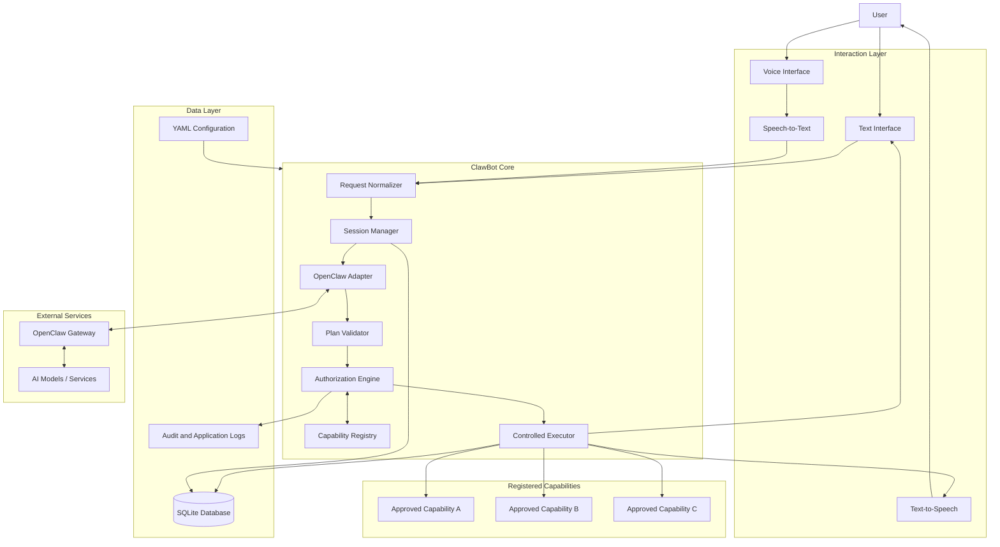
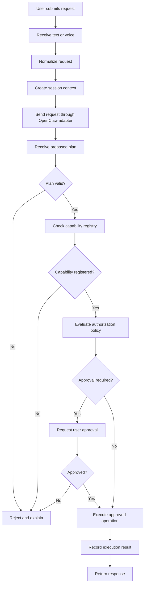
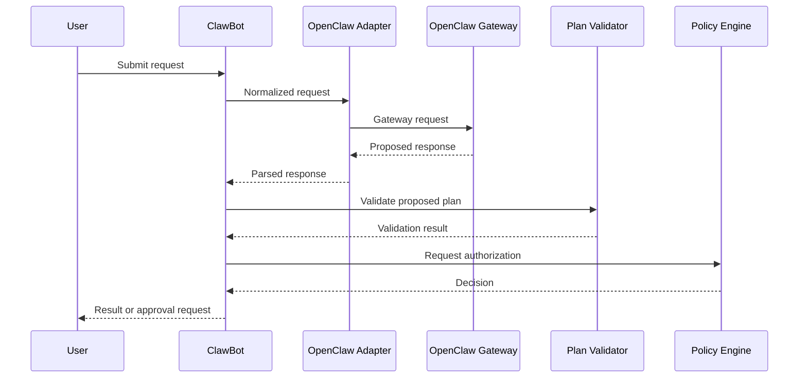
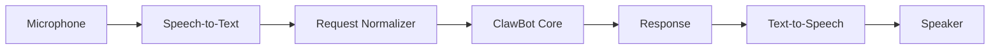
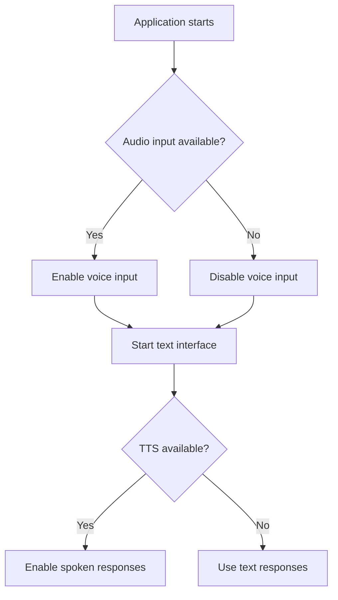
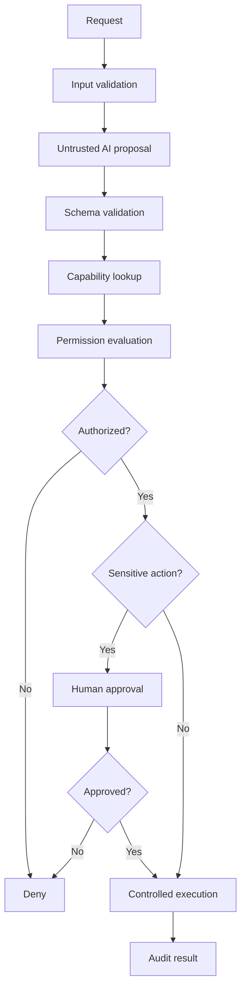
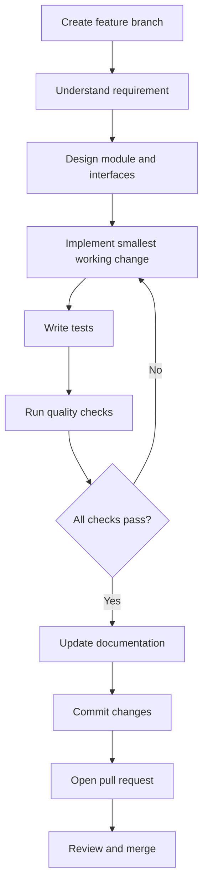
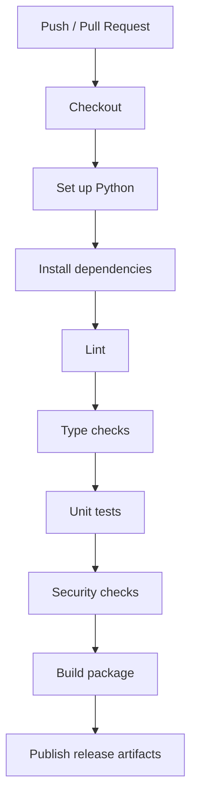

# ClawBot Agent — Intelligent, Secure, Cross-Platform AI Assistant

\<p align="center">   \<strong>A modular AI agent built around OpenClaw orchestration, with unified text and voice interaction, controlled capabilities, and a security-first execution architecture.\</strong> \</p>

\<p align="center">   \<a href="#-overview">Overview\</a> •   \<a href="#-architecture">Architecture\</a> •   \<a href="#-how-it-works">How It Works\</a> •   \<a href="#-security-model">Security\</a> •   \<a href="#-installation">Installation\</a> •   \<a href="#-roadmap">Roadmap\</a> \</p>

---

> [!IMPORTANT]
> ClawBot is designed as an application and control layer around OpenClaw. OpenClaw handles orchestration through its supported integration interface; ClawBot owns user interaction, capability access, authorization, execution policies, application lifecycle, and local persistence.
>
> This README describes the target engineering architecture. A documented design does not automatically mean that a feature is already implemented. Check the implementation status before relying on individual capabilities.

## Table of Contents

- [Overview](#-overview)
- [Why ClawBot?](#-why-clawbot)
- [Core Design Principles](#-core-design-principles)
- [Features and Implementation Status](#-features-and-implementation-status)
- [Architecture](#-architecture)
- [How It Works](#-how-it-works)
- [Engineering Deep Dive](#-engineering-deep-dive)
  - [Interaction Layer](#1-interaction-layer)
  - [Request Normalization](#2-request-normalization)
  - [OpenClaw Integration](#3-openclaw-integration)
  - [Plan Validation](#4-plan-validation)
  - [Authorization Engine](#5-authorization-engine)
  - [Capability Registry](#6-capability-registry)
  - [Execution Engine](#7-execution-engine)
  - [Persistence Layer](#8-persistence-layer)
  - [Voice Pipeline](#9-voice-pipeline)
- [Security Model](#-security-model)
- [Supported Platforms](#-supported-platforms)
- [Project Structure](#-project-structure)
- [Installation](#-installation)
- [Configuration](#-configuration)
- [Development Workflow](#-development-workflow)
- [Testing and Quality](#-testing-and-quality)
- [CI/CD](#-cicd)
- [Documentation](#-documentation)
- [Roadmap](#-roadmap)
- [Limitations](#-limitations)
- [Contributing](#-contributing)
- [References](#-references)

---

## 🧠 Overview

ClawBot is a modular personal AI agent designed to provide a consistent interface for interacting with AI-powered capabilities across different devices and operating systems.

Rather than building another chatbot that only generates responses, the project aims to create a controlled agent environment that can:

- Accept requests through text and voice.
- Interpret user intent through an orchestration backend.
- Convert requests into structured execution plans.
- Validate plans before execution.
- Enforce authorization and security policies.
- Invoke explicitly registered capabilities.
- Store relevant state and execution history.
- Operate with text interaction even when voice services are unavailable.

### The central idea

**AI decides what may be useful. ClawBot decides what is permitted to execute.**

This separation is fundamental to the system.

## 🎯 Why ClawBot?

Traditional chatbot applications primarily focus on generating answers. An agent system introduces additional engineering challenges.

| Engineering problem       | ClawBot's intended approach      |
| ------------------------- | -------------------------------- |
| Multiple input methods    | Unified text and voice pipeline  |
| Uncontrolled model output | Structured plan validation       |
| Unauthorized operations   | Independent authorization engine |
| Unknown tools or actions  | Default-deny capability registry |
| Platform differences      | Platform abstraction layer       |
| Audio dependency          | Text-first fallback              |
| Application state         | Local persistence                |
| Sensitive operations      | Explicit approval workflow       |
| External orchestration    | OpenClaw integration adapter     |

The goal is to build an agent that is extensible without sacrificing control, reliability, or transparency.

## 🧩 Core Design Principles

1. **Security before execution** — model-generated instructions are never automatically trusted.
2. **Separation of concerns** — orchestration, authorization, and execution are independent components.
3. **Text-first reliability** — voice is an optional interaction capability, not a startup requirement.
4. **Explicit capabilities** — only registered and permitted operations can execute.
5. **Platform independence** — operating-system-specific functionality belongs behind adapters.
6. **Observable execution** — operations should have identifiable states and useful logs.
7. **Fail-safe behavior** — unavailable optional services must not disable the core application.
8. **Incremental engineering** — features are introduced with tests, documentation, and acceptance criteria.

## 🚦 Features and Implementation Status

The following is the intended capability matrix. Update the status as implementation and testing progress.

| Capability             | Intended behavior                    | Status           |
| ---------------------- | ------------------------------------ | ---------------- |
| Text interface         | Submit and receive requests          | Planned / verify |
| Voice input            | Speech-to-text interaction           | Planned / verify |
| Voice output           | Text-to-speech responses             | Planned / verify |
| Text fallback          | Continue without microphone or audio | Planned / verify |
| OpenClaw adapter       | Gateway-based orchestration          | Planned / verify |
| Request normalization  | Common request representation        | Planned / verify |
| Plan validation        | Validate model-generated plans       | Planned / verify |
| Authorization engine   | Enforce action permissions           | Planned / verify |
| Capability registry    | Explicitly registered operations     | Planned / verify |
| Approval workflow      | Human approval for sensitive actions | Planned / verify |
| SQLite persistence     | Store local application state        | Planned / verify |
| YAML configuration     | Manage application settings          | Planned / verify |
| Cross-platform support | Windows, Linux, macOS                | Planned / verify |
| Edge-device support    | Raspberry Pi and NVIDIA Jetson       | Planned / verify |
| Automated CI           | Test and validate changes            | Planned / verify |

> [!NOTE]
> Replace `Planned / verify` with `Implemented`, `In Progress`, or `Planned` only after checking the actual source code and tests.

## 🏗️ Architecture

ClawBot separates user interaction, orchestration, policy enforcement, and execution.



### Architectural ownership

| Component            | Responsibility                                                       |
| -------------------- | -------------------------------------------------------------------- |
| ClawBot              | Application lifecycle, interfaces, policies, capabilities, execution |
| OpenClaw             | External orchestration backend                                       |
| AI model             | Interpret requests and propose plans                                 |
| Authorization engine | Decide whether proposed operations are permitted                     |
| Capability registry  | Define available operations and their requirements                   |
| Execution engine     | Run approved, registered operations                                  |
| SQLite               | Persist local state and execution information                        |

## 🔄 How It Works

A request must pass through a controlled lifecycle before an operation is executed.



### Important execution rule

A model response is a proposal, not an authorization token.

Even if an AI model proposes an operation, ClawBot must independently validate the operation, its arguments, the requested capability, and the user's permission.

## 🔬 Engineering Deep Dive

The following sections explain the purpose and responsibilities of each major subsystem.

### 1. Interaction Layer

The interaction layer provides the interface between the user and the agent.

**Text interface**

- Accepts natural-language requests.
- Displays responses and execution status.
- Provides the primary fallback when voice is unavailable.

**Voice interface**

- Captures audio when a supported microphone is available.
- Converts speech into text.
- Sends the recognized text through the same request pipeline.
- Optionally converts final responses into speech.

The interaction layer must not directly invoke privileged system operations.

### 2. Request Normalization

Different input sources must produce a common internal request representation.

For example, these requests should reach the same pipeline:

- Typed: "Show my system information."
- Spoken: "Can you show my system information?"

Conceptual normalized request:

```json
{
  "request_id": "generated-request-id",
  "session_id": "generated-session-id",
  "input_source": "text",
  "text": "Show my system information.",
  "timestamp": "ISO-8601 timestamp"
}
```

The request normalizer should handle:

- Input validation.
- Session association.
- Request identifiers.
- Timestamp metadata.
- Input-source metadata.
- Consistent error handling.

The exact schema should be defined in the implementation and versioned as it evolves.

### 3. OpenClaw Integration

OpenClaw is used as the external orchestration backend.

ClawBot should integrate through OpenClaw's documented Gateway interface rather than depending on undocumented internal APIs.

**Integration responsibilities:**

1. Establish a connection to the configured Gateway.
2. Submit a normalized request.
3. Receive the orchestration response.
4. Validate the response format.
5. Pass the proposed plan to ClawBot's validation and authorization layers.
6. Handle timeouts, connection failures, and malformed responses.



> [!WARNING]
> Do not treat a successful Gateway response as permission to execute a system operation. Gateway connectivity and action authorization are separate concerns.

### 4. Plan Validation

The plan validator protects the application from malformed or unsupported orchestration output.

It should check:

- Required fields.
- Supported operation types.
- Argument schemas.
- Data types.
- Missing or unexpected parameters.
- Capability identifiers.
- Plan size and execution limits.
- Invalid or ambiguous operations.

Example conceptual plan:

```json
{
  "plan_id": "plan-001",
  "steps": [
    {
      "capability": "system.info",
      "arguments": {}
    }
  ]
}
```

This is an illustrative schema, not a claim about OpenClaw's native response format.

### 5. Authorization Engine

Authorization is independent of the orchestration backend.

The engine evaluates whether a requested operation is allowed under ClawBot's configured policies.

| Operation category          | Intended policy                                |
| --------------------------- | ---------------------------------------------- |
| Read-only information       | Allow when explicitly registered and permitted |
| Local application operation | Validate capability and arguments              |
| File modification           | Apply path and permission restrictions         |
| External communication      | Apply destination and data policies            |
| Sensitive operation         | Require explicit approval                      |
| Unknown operation           | Deny by default                                |

The authorization engine should be deterministic and testable.

### 6. Capability Registry

The capability registry defines what the agent is allowed to do.

A capability should have:

- Unique identifier.
- Description.
- Input schema.
- Permission requirements.
- Risk classification.
- Execution handler.
- Timeout and resource limits.
- Logging requirements.

Conceptual capability definition:

```yaml
capabilities:
  - id: system.info
    description: Read approved system information
    enabled: true
    risk: low
    requires_approval: false

  - id: file.write
    description: Write to an explicitly permitted location
    enabled: false
    risk: high
    requires_approval: true
```

Unknown capabilities must remain unavailable until explicitly registered and enabled.

### 7. Execution Engine

The execution engine runs only validated and authorized operations.

Its responsibilities include:

- Resolving the registered capability.
- Validating execution arguments again at the boundary.
- Applying timeouts and resource limits.
- Handling failures and cancellation.
- Recording execution results.
- Preventing unauthorized command execution.

**Design rule:** avoid unrestricted shell execution. If a capability needs to interact with the operating system, expose a narrowly scoped handler with explicit input validation.

### 8. Persistence Layer

SQLite is the intended initial local persistence mechanism.

Potential records include:

| Record               | Purpose                                    |
| -------------------- | ------------------------------------------ |
| Sessions             | Associate requests with a conversation     |
| Requests             | Store request metadata                     |
| Execution history    | Record operation outcomes                  |
| Approval records     | Track approval decisions                   |
| Application settings | Store non-secret configuration             |
| Audit events         | Support troubleshooting and accountability |

Database migrations should be versioned. Secrets should not be stored as ordinary database configuration values.

### 9. Voice Pipeline

Voice should be optional and independent of the core text interface.



Fallback behavior:



The application should remain useful when:

- No microphone is connected.
- No speaker is connected.
- An audio driver is unavailable.
- A speech model cannot load.
- A TTS service is unreachable.

---

## 🔐 Security Model

Security is a core architectural requirement, not an optional enhancement.

### Security boundaries

| Boundary             | Required protection                      |
| -------------------- | ---------------------------------------- |
| User input           | Validate and normalize                   |
| Orchestration output | Treat as untrusted                       |
| Plan validation      | Enforce strict schemas                   |
| Capability access    | Default-deny registry                    |
| Authorization        | Independent policy checks                |
| Sensitive operations | Explicit approval                        |
| Filesystem           | Restrict permitted paths                 |
| Network              | Restrict destinations where applicable   |
| Secrets              | Environment variables or a secret store  |
| Logging              | Avoid credentials and sensitive payloads |

### Security lifecycle



### Security checklist

- [ ] No unrestricted shell execution.
- [ ] No implicit trust in model-generated plans.
- [ ] Unknown capabilities are denied.
- [ ] Sensitive actions require approval.
- [ ] Secrets are excluded from Git.
- [ ] Input and output schemas are validated.
- [ ] Execution timeouts are enforced.
- [ ] Filesystem access is restricted.
- [ ] Security-related tests run in CI.

## 💻 Supported Platforms

The target platform strategy is:

| Platform      | Target                  |
| ------------- | ----------------------- |
| Windows       | Desktop environment     |
| Linux         | Desktop and server      |
| macOS         | Desktop environment     |
| Raspberry Pi  | Edge-device environment |
| NVIDIA Jetson | Edge AI environment     |

> [!IMPORTANT]
> These are target platforms, not a declaration of verified compatibility. Actual support requires successful installation, execution, and test validation on each platform.

Platform-specific code should be isolated behind adapters rather than spread throughout the core application.

## 📁 Project Structure

The following is a proposed logical structure. Align it with the actual repository as modules are implemented.

```text
clawbot_agent-next/
│
├── README.md
├── LICENSE
├── .gitignore
├── .env.example
├── pyproject.toml
│
├── config/
│   ├── default.yaml
│   └── capabilities.yaml
│
├── src/
│   └── clawbot/
│       ├── __init__.py
│       ├── main.py
│       │
│       ├── core/
│       │   ├── runtime.py
│       │   ├── session.py
│       │   └── request.py
│       │
│       ├── interfaces/
│       │   ├── text.py
│       │   └── voice.py
│       │
│       ├── orchestration/
│       │   ├── adapter.py
│       │   └── gateway.py
│       │
│       ├── security/
│       │   ├── validator.py
│       │   ├── authorization.py
│       │   └── approval.py
│       │
│       ├── capabilities/
│       │   ├── registry.py
│       │   └── handlers/
│       │
│       ├── execution/
│       │   └── executor.py
│       │
│       ├── storage/
│       │   ├── database.py
│       │   └── repositories/
│       │
│       └── platform/
│           ├── windows.py
│           ├── linux.py
│           └── macos.py
│
├── tests/
│   ├── unit/
│   ├── integration/
│   ├── security/
│   └── system/
│
├── scripts/
│   ├── install.sh
│   └── install.ps1
│
├── docs/
│   ├── ARCHITECTURE.md
│   ├── SYSTEM_DESIGN.md
│   ├── DEVELOPMENT.md
│   ├── SECURITY.md
│   ├── ORCHESTRATION.md
│   ├── INSTALLATION.md
│   ├── TESTING.md
│   ├── ROADMAP_AND_RELEASES.md
│   ├── VOICE_AND_INTERACTION.md
│   └── REFERENCES.md
│
└── .github/
    └── workflows/
        └── ci.yml
```

## ⚙️ Installation

### Prerequisites

- Git
- Python version specified by the project configuration
- OpenClaw installation and Gateway access for orchestration features
- A supported operating system

Optional voice dependencies should not be mandatory for text-only operation.

### 1. Clone the repository

```bash
git clone https://github.com/Achyut0617/clawbot_agent.git
cd clawbot_agent
```

If you are working with your local `clawbot_agent-next` directory, use that directory instead.

### 2. Create a virtual environment

**Windows PowerShell**

```powershell
python -m venv .venv
.venv\Scripts\Activate.ps1
```

**Linux / macOS**

```bash
python3 -m venv .venv
source .venv/bin/activate
```

### 3. Install dependencies

Use the dependency installation method defined by the repository's actual `pyproject.toml` or requirements file.

For a project that uses `requirements.txt`:

```bash
python -m pip install --upgrade pip
pip install -r requirements.txt
```

### 4. Configure environment variables

Create a local `.env` file from the supplied example if the project provides one.

```bash
cp .env.example .env
```

On Windows PowerShell:

```powershell
Copy-Item .env.example .env
```

Configure the OpenClaw Gateway connection using the documented settings for your integration.

### 5. Start ClawBot

Use the entry point and command defined by the current implementation. For example, if `src/clawbot/main.py` is the configured entry point:

```bash
python -m clawbot.main
```

> [!NOTE]
> The directory structure and startup command above are proposed conventions. Confirm the actual package layout and entry point before using them.

## 🛠️ Configuration

Configuration should be separated into non-secret YAML settings and secret values supplied through environment variables or a secret manager.

Illustrative YAML:

```yaml
application:
  name: clawbot
  environment: development
  log_level: INFO

interaction:
  text_enabled: true
  voice_enabled: false

orchestration:
  provider: openclaw
  gateway_url: ${OPENCLAW_GATEWAY_URL}

security:
  default_policy: deny
  approval_required_for_sensitive_actions: true

storage:
  backend: sqlite
  path: data/clawbot.db
```

Illustrative environment variables:

```dotenv
OPENCLAW_GATEWAY_URL=
OPENCLAW_GATEWAY_TOKEN=
```

Do not commit real credentials, tokens, or private configuration files.

## 🧪 Development Workflow

The development workflow should keep implementation, tests, and documentation synchronized.



### Suggested branch naming

```text
feature/text-interface
feature/openclaw-adapter
feature/request-normalization
feature/authorization-engine
feature/voice-pipeline
fix/gateway-timeout
test/security-validation
docs/architecture-update
```

### Suggested commit conventions

```text
feat: add normalized request model
feat: introduce capability registry
feat: implement OpenClaw gateway adapter
fix: handle gateway connection timeout
test: add authorization policy tests
docs: document execution lifecycle
refactor: separate platform adapters
ci: add cross-platform test workflow
```

## 🔍 Testing and Quality

Testing should validate the application at multiple levels.

| Test category    | What it validates                           |
| ---------------- | ------------------------------------------- |
| Unit             | Individual modules and functions            |
| Integration      | Communication between components            |
| Security         | Authorization and validation boundaries     |
| System           | End-to-end request lifecycle                |
| Platform         | OS-specific compatibility                   |
| Failure handling | Unavailable services and degraded operation |

### Important test scenarios

- [ ] Text request works without audio dependencies.
- [ ] Voice input reaches the same normalized request pipeline.
- [ ] Invalid orchestration output is rejected.
- [ ] Unknown capabilities are denied.
- [ ] Unauthorized actions never execute.
- [ ] Sensitive operations require approval.
- [ ] Gateway timeouts are handled.
- [ ] Database failures produce controlled errors.
- [ ] Optional TTS failure does not break text responses.
- [ ] Application logs do not expose secrets.

Example test command, if pytest is configured:

```bash
python -m pytest -v
```

## 🔁 CI/CD

GitHub Actions should automate code-quality and compatibility checks.

The intended pipeline:



Recommended CI responsibilities:

- Dependency installation.
- Formatting and lint checks.
- Static type checking.
- Unit and integration tests.
- Security and dependency scanning.
- Package build validation.
- OS and Python-version compatibility matrix.

Deployment and publishing should be separate controlled release stages, not automatic consequences of every successful test run.

## 📚 Documentation

The documentation is intended to explain both how ClawBot works and why each subsystem exists.

| Document                                               | Purpose                               |
| ------------------------------------------------------ | ------------------------------------- |
| [Architecture](docs/ARCHITECTURE.md)                   | High-level system architecture        |
| [System Design](docs/SYSTEM_DESIGN.md)                 | Components, boundaries, and data flow |
| [Development](docs/DEVELOPMENT.md)                     | Local development workflow            |
| [Security](docs/SECURITY.md)                           | Threat model and authorization        |
| [Orchestration](docs/ORCHESTRATION.md)                 | OpenClaw integration                  |
| [Installation](docs/INSTALLATION.md)                   | Setup and installation                |
| [Testing](docs/TESTING.md)                             | Testing strategy                      |
| [Roadmap and Releases](docs/ROADMAP_AND_RELEASES.md)   | Milestones and release planning       |
| [Voice and Interaction](docs/VOICE_AND_INTERACTION.md) | Text and voice interaction            |
| [References](docs/REFERENCES.md)                       | Technical references                  |

## 🗺️ Roadmap

The roadmap is organized around engineering milestones rather than a collection of disconnected features.

### Phase 1 — Foundation

- [ ] Establish application package structure.
- [ ] Define configuration schema.
- [ ] Implement application lifecycle.
- [ ] Define normalized request model.
- [ ] Establish logging and error handling.

### Phase 2 — Orchestration

- [ ] Verify supported OpenClaw Gateway integration.
- [ ] Implement Gateway adapter.
- [ ] Add connection and timeout handling.
- [ ] Validate orchestration response schemas.

### Phase 3 — Security and Execution

- [ ] Implement capability registry.
- [ ] Implement plan validation.
- [ ] Implement authorization engine.
- [ ] Add approval workflow.
- [ ] Implement controlled executor.
- [ ] Add security regression tests.

### Phase 4 — Interaction

- [ ] Implement text interface.
- [ ] Integrate optional speech-to-text.
- [ ] Integrate optional text-to-speech.
- [ ] Implement text fallback.
- [ ] Test microphone and audio failure scenarios.

### Phase 5 — Persistence and Reliability

- [ ] Implement SQLite persistence.
- [ ] Add database migrations.
- [ ] Add execution history.
- [ ] Add structured audit events.
- [ ] Test restart and recovery behavior.

### Phase 6 — Cross-Platform Engineering

- [ ] Validate Windows.
- [ ] Validate Linux.
- [ ] Validate macOS.
- [ ] Evaluate Raspberry Pi support.
- [ ] Evaluate NVIDIA Jetson support.
- [ ] Build platform-specific installers.

### Phase 7 — Release Engineering

- [ ] Complete CI matrix.
- [ ] Add security and dependency checks.
- [ ] Build distributable packages.
- [ ] Document release process.
- [ ] Publish a verified stable release.

## ⚠️ Limitations

The project should explicitly document limitations as implementation progresses.

Potential constraints include:

- OpenClaw Gateway availability and configuration.
- External model and service availability.
- Hardware resource limitations on edge devices.
- Speech recognition accuracy and audio hardware compatibility.
- Operating-system-specific permission requirements.
- Network latency and service timeouts.
- Capability availability across platforms.

A capability should not be advertised as supported until it has been implemented and tested.

## 🤝 Contributing

Contributions should follow a reviewable engineering process.

1. Understand the relevant architecture and module boundaries.
2. Open or select an issue describing the change.
3. Create a feature or fix branch.
4. Implement the smallest coherent change.
5. Add tests for expected and failure behavior.
6. Update relevant documentation.
7. Run quality checks.
8. Submit a pull request with implementation details and test evidence.

### Contribution principles

- Keep modules focused.
- Avoid undocumented interfaces.
- Do not bypass authorization.
- Never commit secrets.
- Add tests for security-sensitive changes.
- Document platform-specific behavior.
- Prefer small, reviewable commits.

## 📖 References

- [OpenClaw documentation](https://docs.openclaw.ai/)
- [OpenClaw GitHub repository](https://github.com/openclaw/openclaw)
- [Python documentation](https://docs.python.org/3/)
- [SQLite documentation](https://www.sqlite.org/docs.html)
- [PyYAML documentation](https://pyyaml.org/wiki/PyYAMLDocumentation)
- [GitHub Actions documentation](https://docs.github.com/en/actions)
- [Mermaid documentation](https://mermaid.js.org/)

---

\<p align="center">
&#x20; \<strong>ClawBot Agent\</strong>
&#x20; \<br/>
&#x20; Building a controlled, modular, and extensible AI agent.
&#x20; \<br/>\<br/>
&#x20; \<sub>Designed for engineering transparency, security, and cross-platform evolution.\</sub>
\</p>
