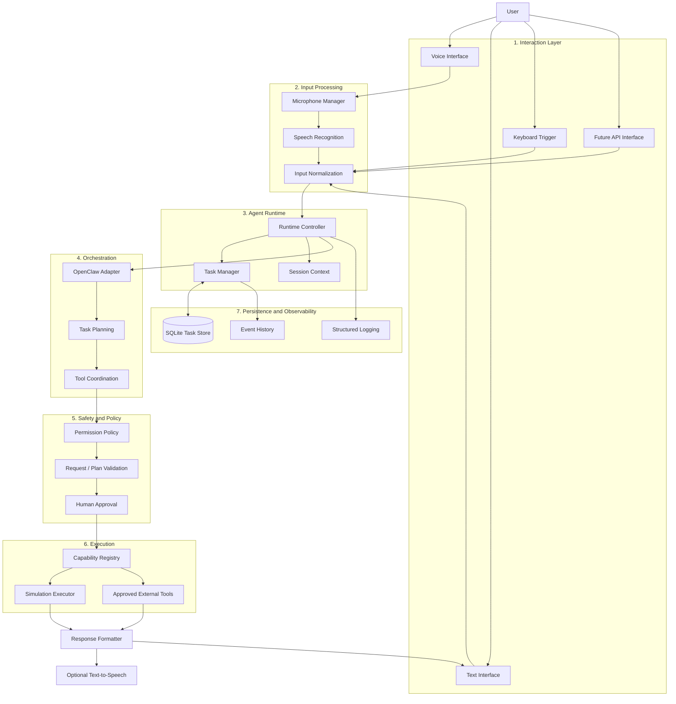
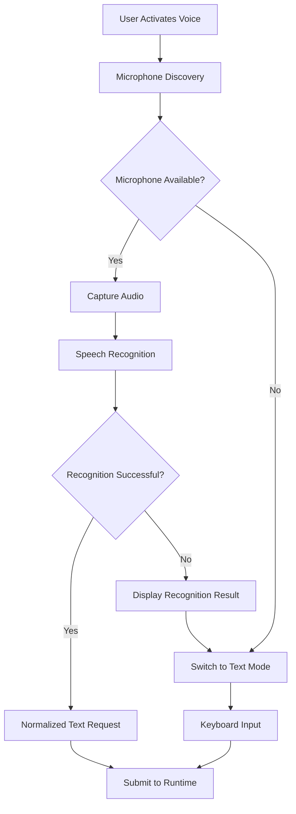
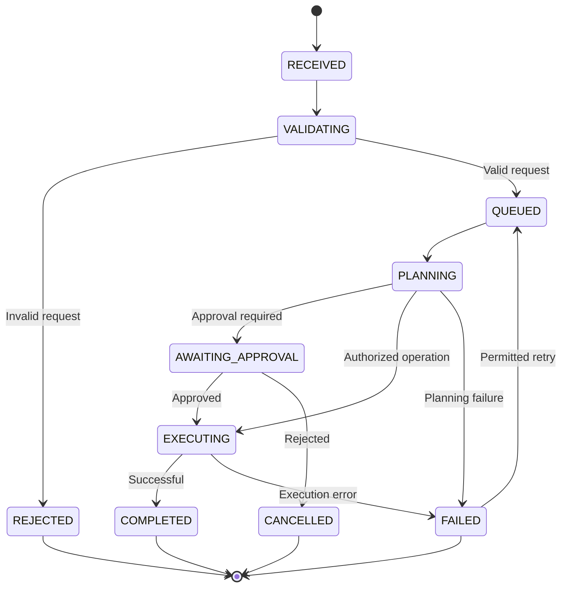
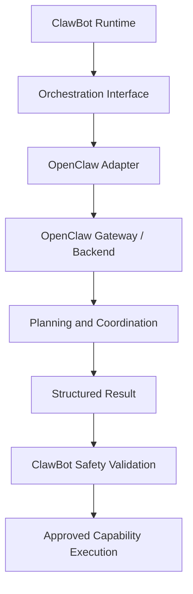
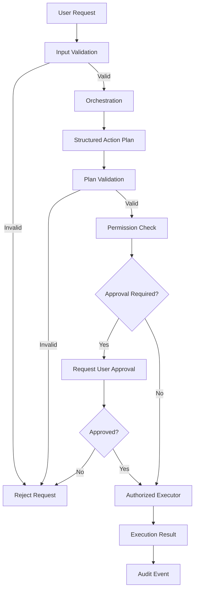

# ClawBot Agent — System Architecture

**Document ID:** CLAW-DOC-001  
**Version:** 1.0.0  
**Document Type:** Technical Architecture Specification  
**Project:** ClawBot Agent  
**Architecture Style:** Modular, Event-Driven, Local-First Agent Architecture  
**Primary Language:** Python  
**Orchestration Direction:** OpenClaw  
**Deployment Target:** Windows, Linux, macOS, NVIDIA Jetson and Raspberry Pi  
**Execution Policy:** Simulation-first, safety-controlled execution  

---

# 1. Introduction

## 1.1 Project Overview

ClawBot Agent is a modular, locally operated intelligent agent designed to interpret user instructions, coordinate AI-driven tasks, invoke permitted capabilities and provide interactive feedback through voice and text interfaces.

The project aims to establish a unified agent architecture that separates user interaction, natural-language understanding, task orchestration, execution control, safety enforcement and persistent task management.

Unlike a conventional voice assistant that primarily converts speech into text and returns a response, ClawBot is designed around an execution-oriented architecture. It should be capable of receiving an instruction, understanding its intent, determining the required operations, coordinating appropriate tools, monitoring execution and communicating the outcome.

The system is being developed with a local-first philosophy. Where practical, speech recognition, application services, task persistence and model inference should operate locally. External services may be integrated through explicitly configured interfaces.

The architecture is designed to support multiple input mechanisms, including:

- Voice commands through a microphone.
- Keyboard-triggered interaction.
- Direct text-based commands.
- Programmatic requests through future API interfaces.
- Remote device interaction through future gateway extensions.

The system should remain operational in text mode even when audio hardware or speech-recognition dependencies are unavailable.

## 1.2 Engineering Vision

The long-term objective is to develop ClawBot into a portable personal agent runtime rather than a single-purpose voice-controlled robot application.

The architecture should support:

1. Device-independent interaction.
2. Pluggable speech and language-model providers.
3. External orchestration through OpenClaw.
4. Structured and traceable task execution.
5. Permission-controlled tool invocation.
6. Persistent task and event management.
7. Fault recovery and graceful degradation.
8. Cross-platform installation and deployment.
9. Extensible capabilities and future multi-agent coordination.

These objectives influence the separation of modules and the communication contracts between subsystems.

## 1.3 Architectural Design Principles

| Principle | Engineering interpretation |
|---|---|
| Modularity | Each subsystem owns a clearly defined responsibility. |
| Separation of concerns | Input, planning, orchestration, safety and execution remain independent. |
| Local-first | Local execution is preferred where practical. |
| Provider independence | Speech and model providers should be replaceable. |
| Safety by design | Generated plans must pass independent validation. |
| Observability | Tasks, state changes, failures and execution outcomes must be traceable. |
| Portability | Platform-specific dependencies must remain isolated. |
| Fault tolerance | Failure of optional components should not unnecessarily terminate the entire application. |
| Extensibility | New capabilities should be introduced through defined interfaces. |
| Reproducibility | Configuration, dependencies and development changes should be version-controlled. |

---

# 2. Problem Definition and Motivation

## 2.1 Existing Interaction Limitations

Traditional command-line applications require users to remember specific commands and application syntax.

Voice assistants improve accessibility but often operate as request-response systems without a clearly defined execution lifecycle.

An intelligent execution-oriented agent requires additional engineering capabilities:

- Understanding user intent.
- Translating natural-language instructions into actionable tasks.
- Determining which capabilities are required.
- Managing dependencies between operations.
- Validating requested operations.
- Monitoring execution.
- Handling incomplete or failed operations.
- Maintaining execution history.

These responsibilities cannot reliably be handled by speech recognition or an LLM alone.

## 2.2 Core Engineering Problem

The central engineering problem is:

**How can a locally accessible intelligent agent accept heterogeneous user inputs, coordinate AI-driven operations, enforce execution constraints and maintain a reliable, observable task lifecycle across different computing environments?**

ClawBot addresses this through a modular runtime and an orchestration-oriented architecture.

## 2.3 Design Requirements

The architecture establishes the following functional requirements:

| ID | Requirement | Description |
|---|---|---|
| FR-001 | Voice input | Accept microphone-based instructions when supported. |
| FR-002 | Text input | Accept direct typed instructions. |
| FR-003 | Trigger handling | Support keyboard-based activation. |
| FR-004 | Input normalization | Convert different input sources into a common request representation. |
| FR-005 | Orchestration | Delegate task interpretation and coordination to the configured orchestration backend. |
| FR-006 | Safety validation | Apply permission and execution policies before actions are performed. |
| FR-007 | Task management | Track task identity, status and execution history. |
| FR-008 | Feedback | Communicate results through text and optional audio. |
| FR-009 | Configuration | Support configurable model, audio and runtime settings. |
| FR-010 | Portability | Support platform-aware installation and runtime configuration. |

## 2.4 Non-Functional Requirements

| ID | Requirement | Engineering objective |
|---|---|---|
| NFR-001 | Reliability | Handle component failures without unnecessary application termination. |
| NFR-002 | Security | Restrict tool access and sensitive operations. |
| NFR-003 | Maintainability | Keep components independently understandable and testable. |
| NFR-004 | Portability | Avoid unnecessary operating-system-specific dependencies. |
| NFR-005 | Performance | Minimize unnecessary processing and interaction latency. |
| NFR-006 | Observability | Maintain structured logs and task events. |
| NFR-007 | Extensibility | Allow new input providers and execution capabilities. |
| NFR-008 | Recoverability | Preserve sufficient task information to diagnose failures and recover where possible. |

---

# 3. Architectural Evolution

ClawBot is evolving from a voice-controlled robotic simulation into a generalized agent runtime.

## 3.1 Original Architecture — Voice-Controlled Robot Prototype

The original implementation follows a sequential processing pipeline.

**Input → Speech Recognition → LLM Planning → Safety Validation → Robot Simulation → Voice Feedback**

The original technology stack includes:

- Python.
- Vosk for offline speech recognition.
- Ollama for local LLM inference.
- Qwen 2.5 (1.5B) for instruction interpretation.
- Structured JSON action planning.
- Custom instruction-level and plan-level safety validation.
- Simulated robot execution.
- Text-to-speech feedback.
- Python unittest-based testing.

The original system focuses on interpreting movement-oriented instructions and converting them into predefined simulated robot actions.

Physical motor actuation is disabled.

## 3.2 Architectural Limitations of the Original Design

Although the original pipeline establishes the core interaction and safety concepts, a larger personal agent requires additional architectural separation.

The major limitations addressed by the new design are:

1. Input handling is too closely associated with the voice interaction pipeline.
2. Text interaction should not depend on microphone initialization.
3. Task lifecycle management requires a dedicated component.
4. Orchestration should be replaceable independently of user interfaces.
5. Persistent task history should be independent of execution logic.
6. Installation and environment management require a dedicated subsystem.
7. Cross-platform deployment requires explicit platform abstraction.
8. CI/CD and atomic development tracking must be incorporated into the engineering lifecycle.

## 3.3 Target Architecture

The new architecture introduces a unified runtime that accepts requests from multiple interaction sources and forwards normalized instructions to a common orchestration layer.

The runtime is intended to become the central coordination point for the application.

This separation allows the system to evolve without requiring independent execution implementations for voice and text.

---

# 4. High-Level System Architecture

## 4.1 Architecture Overview

The target architecture is organized into seven logical layers.

1. Interaction Layer
2. Input Processing Layer
3. Runtime and Coordination Layer
4. Orchestration Layer
5. Safety and Policy Layer
6. Execution and Capability Layer
7. Persistence and Observability Layer

These are logical responsibilities, not necessarily separate operating-system processes.

## 4.2 System Architecture Diagram



## 4.3 Layer Responsibilities

### Layer 1: Interaction

Responsible for accepting user requests.

Components:

- Voice interface.
- Text interface.
- Keyboard activation.
- Future API interface.

The interaction layer should not contain AI planning or execution logic.

Its primary responsibility is to acquire the request and deliver it to the runtime.

### Layer 2: Input Processing

Responsible for converting different input sources into a consistent representation.

For voice input:

Microphone → Audio Buffer → Speech Recognition → Recognized Text.

For text input:

Keyboard → Text Request → Input Normalization.

Both paths should eventually produce the same logical request structure.

### Layer 3: Agent Runtime

The runtime coordinates the lifecycle of a request.

Responsibilities include:

- Receiving normalized input.
- Assigning task identifiers.
- Initializing execution context.
- Coordinating orchestration.
- Managing task status.
- Handling failures.
- Persisting task events.
- Returning results.

The runtime should not directly implement individual external tools.

### Layer 4: Orchestration

The orchestration layer is responsible for task interpretation and coordination.

OpenClaw is the intended orchestration backend.

Its responsibilities may include:

- Understanding user intent.
- Breaking complex instructions into operations.
- Selecting available tools.
- Coordinating dependent tasks.
- Managing execution sequences.
- Returning results to the runtime.

The OpenClaw adapter isolates backend-specific communication from the rest of the application.

### Layer 5: Safety and Policy

This layer establishes independent execution restrictions.

Responsibilities:

- Validate requests.
- Check action permissions.
- Enforce parameter constraints.
- Require approval for sensitive actions.
- Reject unsupported operations.
- Prevent unauthorized execution.

Safety validation must not depend exclusively on the LLM's own decision.

### Layer 6: Execution and Capabilities

This layer contains the operations the agent is actually permitted to perform.

Examples:

- Robot simulation.
- Approved file operations.
- Application integrations.
- System information retrieval.
- Future device-specific operations.

Each capability should expose a controlled interface rather than unrestricted access to the host operating system.

### Layer 7: Persistence and Observability

Responsible for maintaining application state and diagnostic information.

The initial storage design uses SQLite.

It should track:

- Task identity.
- Original request.
- Input source.
- Current status.
- Execution timestamps.
- Execution result.
- Error information.
- Approval events.
- Task history.

---

# 5. Unified Input Architecture

## 5.1 Design Motivation

One of the most important design decisions is separating the input mechanism from the agent's execution mechanism.

A voice command and a typed command should not create two different execution pipelines.

For example:

Voice input:

"Explain my project architecture."

Text input:

"Explain my project architecture."

Both should produce equivalent normalized requests.

## 5.2 Input Normalization

A normalized request should conceptually contain:

| Field | Purpose |
|---|---|
| request_id | Unique request identifier |
| source | Voice, text, keyboard or API |
| content | Recognized or typed instruction |
| timestamp | Request creation time |
| session_id | Associated interaction session |
| metadata | Optional input-specific information |

Illustrative representation:

```json
{
  "request_id": "req-example-001",
  "source": "text",
  "content": "Explain my project architecture",
  "timestamp": "2026-11-17T12:00:00Z",
  "session_id": "session-example-001",
  "metadata": {}
}
```

This is an architectural example, not a claim that this exact schema is already implemented.

## 5.3 Voice Input Pipeline



## 5.4 Microphone Failure and Text Fallback

Microphone availability is an optional capability, not a mandatory application dependency.

The application should follow this behavior:

1. Initialize the main runtime.
2. Attempt microphone discovery when voice functionality is requested.
3. Check whether the audio device is accessible.
4. Initialize speech recognition only if the required dependencies are available.
5. If microphone initialization fails, report the issue.
6. Keep the text interface operational.
7. Allow the user to continue submitting instructions.

The application must not terminate simply because the microphone is disconnected.

## 5.5 Interaction Modes

The target system should support the following modes:

| Mode | Activation | Requirement |
|---|---|---|
| Text mode | Direct terminal input | Keyboard |
| Push-to-talk | Keyboard shortcut or configured trigger | Microphone |
| Wake-word mode | Configured wake word | Microphone |
| Command mode | CLI command | Terminal |
| API mode | HTTP request | Future API service |

Push-to-talk and wake-word detection are separate interaction mechanisms.

Wake-word detection requires an additional audio monitoring subsystem and should be introduced independently.

---

# 6. Runtime and Task Lifecycle

## 6.1 Runtime Responsibilities

The runtime is the central coordinator between user interaction and orchestration.

It should provide a single request submission interface irrespective of the input source.

Conceptually:

```python
class AgentRuntime:

    def submit(self, request):
        """
        Accept a normalized request.

        1. Validate request structure.
        2. Create task identity.
        3. Persist initial state.
        4. Invoke orchestration.
        5. Coordinate safety checks.
        6. Record execution outcome.
        7. Return structured feedback.
        """
        pass
```

This is an architectural interface illustration, not a replacement implementation.

## 6.2 Task Lifecycle

Every submitted instruction should be associated with a task identity.

The task lifecycle provides a consistent mechanism for monitoring execution.



The exact state names and transitions should be reconciled with the implementation before being enforced as the database schema.

## 6.3 Task Status Definitions

| State | Meaning |
|---|---|
| RECEIVED | A new request has entered the runtime. |
| VALIDATING | Input structure and initial policies are being checked. |
| QUEUED | Request is accepted and waiting for processing. |
| PLANNING | Orchestration is determining the required operations. |
| AWAITING_APPROVAL | A human decision is required. |
| EXECUTING | An approved operation is running. |
| COMPLETED | Execution finished successfully. |
| FAILED | Processing or execution failed. |
| REJECTED | The request violated a policy. |
| CANCELLED | Execution was cancelled. |

A retry must be controlled. Non-idempotent operations must not be repeated blindly.

## 6.4 Task Persistence

SQLite is the initial persistence layer.

The intended logical entities are:

**Task**

- task_id
- request_id
- session_id
- input_source
- request_content
- status
- created_at
- updated_at
- result
- error

**Task Event**

- event_id
- task_id
- event_type
- event_data
- timestamp

**Approval Record**

- approval_id
- task_id
- requested_action
- decision
- decision_timestamp

The final database schema must be derived from the actual storage implementation.

---

# 7. Orchestration Architecture

## 7.1 Why an Independent Orchestration Layer?

An LLM can interpret instructions and generate plans, but generating a plan is not equivalent to safely executing it.

A separate orchestration layer is required to coordinate operations, while independent policy controls determine what may actually execute.

ClawBot uses an adapter-based design to isolate orchestration-specific implementation details.

## 7.2 OpenClaw Integration

OpenClaw is the intended external orchestration backend.

The integration should follow this conceptual architecture:



The adapter should isolate:

- Backend connection configuration.
- Request formatting.
- Response parsing.
- Timeout handling.
- Authentication configuration.
- Error translation.
- Connection health checks.

The runtime should not need to understand backend-specific message formats.

## 7.3 Orchestration Contract

The orchestration interface should conceptually support:

```python
class Orchestrator:

    def plan(self, request):
        """Interpret a request and return a structured plan."""
        raise NotImplementedError

    def execute(self, plan):
        """Coordinate execution through permitted capabilities."""
        raise NotImplementedError

    def health_check(self):
        """Check orchestration backend availability."""
        raise NotImplementedError
```

This illustrates the intended abstraction. Actual adapter methods and their signatures must match the implementation.

## 7.4 Provider Independence

The architecture should avoid embedding a specific LLM provider throughout the runtime.

The original prototype uses Ollama with Qwen 2.5 (1.5B).

The new architecture introduces OpenClaw as the intended orchestration integration.

These are different architectural responsibilities:

- Model inference provides language-model capabilities.
- Orchestration coordinates agent behavior and tool use.
- The runtime manages the application lifecycle.
- Safety controls enforce execution boundaries.

The architecture should permit different providers without requiring changes to the input or persistence layers.

---

# 8. Safety and Execution Architecture

## 8.1 Safety Philosophy

ClawBot is an execution-oriented application. Therefore, safety must be treated as an architectural requirement rather than an optional feature.

An AI-generated response or plan must never be considered inherently trustworthy.

Every executable operation should pass through independently enforced authorization and validation mechanisms.

## 8.2 Layered Safety Model

The target design establishes the following controls:

**Layer 1 — Request Validation**

Checks:

- Request structure.
- Missing input.
- Unsupported commands.
- Invalid parameters.

**Layer 2 — Planning Validation**

Checks:

- Action type.
- Required arguments.
- Parameter ranges.
- Capability availability.
- Plan structure.

**Layer 3 — Authorization**

Checks:

- Permission policy.
- User approval requirements.
- Capability access.
- Restricted operations.

**Layer 4 — Execution Control**

Checks:

- Executor availability.
- Execution limits.
- Timeouts.
- Cancellation.
- Result validation.

## 8.3 Safety Pipeline



## 8.4 Simulation-First Execution

The original robotic implementation is simulation-only.

The new runtime must preserve this boundary until physical hardware integration is independently designed, tested and authorized.

A future hardware executor should require:

- Explicit device identification.
- Hardware-specific capability registration.
- Movement constraints.
- Emergency-stop support.
- Independent command validation.
- Physical safety testing.

An LLM must never directly transmit unrestricted motor commands.

---

# 9. Persistence and Observability

## 9.1 Storage Architecture

The initial persistence approach uses SQLite.

SQLite is suitable for the initial single-device application because it provides local persistence without requiring a separately managed database server.

The storage interface should remain independent of runtime and orchestration logic.

## 9.2 Event Tracking

Important lifecycle events should be recorded.

Examples:

```text
REQUEST_RECEIVED
REQUEST_VALIDATED
TASK_CREATED
ORCHESTRATION_STARTED
PLAN_GENERATED
APPROVAL_REQUESTED
APPROVAL_GRANTED
EXECUTION_STARTED
EXECUTION_COMPLETED
EXECUTION_FAILED
TASK_CANCELLED
```

These are proposed event identifiers. Their final names should be standardized in the implementation.

## 9.3 Observability Requirements

The logging system should provide:

- Timestamped events.
- Task correlation identifiers.
- Component identifiers.
- Severity levels.
- Failure context.
- Execution duration.
- Approval decisions.

Sensitive information, authentication credentials and private user data must not be written into ordinary logs.

---

# 10. Cross-Platform Architecture

## 10.1 Portability Objective

ClawBot should not depend on a single operating system.

The target deployment environments are:

| Platform | Intended use |
|---|---|
| Windows | Primary development and desktop environment |
| Linux | General-purpose local deployment |
| macOS | Desktop deployment |
| NVIDIA Jetson | Edge AI deployment |
| Raspberry Pi | Lightweight edge and embedded deployment |

Platform support must be validated individually. Listing a platform as a target does not imply that every dependency or feature is already supported on it.

## 10.2 Platform Abstraction

Platform-specific responsibilities should be isolated.

Examples:

- Microphone discovery.
- Audio device initialization.
- Keyboard shortcut registration.
- Startup configuration.
- Process management.
- Filesystem paths.
- Optional hardware integrations.

The core runtime should avoid directly depending on operating-system-specific APIs wherever practical.

## 10.3 Installation Subsystem

Installation and environment management should be treated as independent engineering responsibilities.

The installation subsystem is intended to manage:

1. Platform detection.
2. Python availability.
3. Virtual environment creation.
4. Package installation.
5. Optional audio dependencies.
6. Configuration initialization.
7. External service prerequisites.
8. Runtime health verification.

The installation scripts should be idempotent where practical, meaning that running them again should not unnecessarily damage an existing installation.

---

# 11. Fault Tolerance and Failure Management

A robust agent should distinguish between critical and optional subsystem failures.

| Failure | Expected behavior |
|---|---|
| Microphone unavailable | Continue in text mode. |
| Speech recognition unavailable | Disable voice functionality and retain text input. |
| LLM backend unavailable | Report orchestration failure; do not fabricate a successful execution. |
| OpenClaw unavailable | Mark dependent tasks appropriately and expose a recoverable connection error. |
| SQLite write failure | Stop accepting work that cannot be tracked safely. |
| Invalid action plan | Reject the plan before execution. |
| Permission denied | Reject the operation and explain why. |
| Executor failure | Record failure and return an appropriate result. |
| Audio output unavailable | Display textual feedback. |

## 11.1 Graceful Degradation

Graceful degradation means that optional capabilities may become unavailable without making the entire application unusable.

For example:

```text
Normal operation
    |
    +-- Voice available
    |      |
    |      +-- Voice and text enabled
    |
    +-- Voice unavailable
           |
           +-- Text mode remains enabled
```

This is a central requirement for ClawBot.

## 11.2 Retry Strategy

Retries should be implemented selectively.

Recommended principles:

- Retry transient connection failures.
- Use bounded retry counts.
- Introduce backoff between attempts.
- Preserve task identity across retries.
- Avoid automatically repeating non-idempotent operations.
- Record every retry attempt.

---

# 12. Performance and Resource Considerations

ClawBot is intended to operate across devices with different computational resources.

Consequently, model inference and audio processing should remain configurable.

Important performance considerations include:

| Area | Measurement |
|---|---|
| Input | Request acquisition latency |
| Speech | Speech-to-text processing time |
| Orchestration | Backend response latency |
| Planning | Plan generation duration |
| Execution | Capability execution duration |
| Storage | Task persistence latency |
| Memory | RAM consumption |
| CPU | Runtime CPU utilization |
| GPU | Optional inference utilization |

The system should eventually benchmark:

- Text request latency.
- Voice request latency.
- Orchestration overhead.
- Task persistence overhead.
- Startup time.
- Idle memory consumption.
- Resource utilization under concurrent requests.

No performance benchmarks are claimed in this document because validated measurements have not yet been established.

---

# 13. Repository-Level Architecture Mapping

The new repository separates implementation responsibilities by subsystem.

```text
clawbot_agent/
│
├── .github/
│   └── workflows/
│       ├── ci.yml
│       └── release.yml
│
├── config/
│   └── settings.yaml
│
├── docs/
│   ├── ARCHITECTURE.md
│   ├── DEVELOPMENT.md
│   ├── SECURITY.md
│   └── ...
│
├── legacy/
│   └── Original application
│
├── models/
│   └── vosk/
│
├── scripts/
│   ├── install.ps1
│   └── install.sh
│
├── src/
│   └── clawbot/
│       ├── __init__.py
│       ├── cli.py
│       ├── config.py
│       ├── models.py
│       ├── runtime.py
│       ├── orchestrator.py
│       ├── safety.py
│       ├── audio.py
│       └── store.py
│
├── tests/
│   ├── test_orchestrator.py
│   ├── test_safety.py
│   └── test_store.py
│
├── .env.example
├── .gitignore
├── CHANGELOG.md
├── LICENSE
├── pyproject.toml
├── README.md
└── ROADMAP.yaml
```

## 13.1 Module Responsibility Mapping

| Module | Architectural responsibility |
|---|---|
| cli.py | Command-line interaction and application entry point |
| runtime.py | Central request and task coordination |
| orchestrator.py | Orchestration backend integration |
| audio.py | Audio input and speech-related functionality |
| safety.py | Request and action policy enforcement |
| store.py | Persistent task and event management |
| models.py | Shared data representations |
| config.py | Runtime configuration loading |
| settings.yaml | Application configuration |

This mapping describes the intended responsibilities. Actual exported functions, classes and interfaces must be documented against their implementation.

## 13.2 Dependency Direction

The desired dependency direction is:

```text
CLI / Voice / Future API
          |
          v
     Agent Runtime
          |
          +------> Orchestration Adapter
          |
          +------> Safety Policy
          |
          +------> Task Store
          |
          +------> Feedback System
```

Lower-level infrastructure should not depend on user-interface implementations.

This reduces coupling and improves testability.

---

# 14. Architectural Decisions and Trade-offs

## ADR-001: Unified Input Interface

**Decision:** Voice and text input must converge into a common request representation.

**Reason:** Prevents duplicated execution logic and allows new interaction methods.

**Trade-off:** Requires a normalized request contract and input adapters.

## ADR-002: Local-First Runtime

**Decision:** Prefer local execution for core application services where practical.

**Reason:** Reduces unnecessary cloud dependencies and provides better control over local data.

**Trade-off:** Local hardware resources may limit model size and inference performance.

## ADR-003: OpenClaw as Orchestration Backend

**Decision:** Integrate OpenClaw through an isolated adapter.

**Reason:** Keeps orchestration-specific behavior separate from the application runtime.

**Trade-off:** Introduces an external runtime dependency and requires connection management.

## ADR-004: SQLite for Initial Persistence

**Decision:** Use SQLite as the initial task persistence mechanism.

**Reason:** Lightweight, locally accessible and suitable for a single-device prototype.

**Trade-off:** Multi-device synchronization and high-concurrency workloads may require a different storage architecture.

## ADR-005: Independent Safety Validation

**Decision:** Keep policy enforcement outside the LLM-generated planning process.

**Reason:** Prevents the model from being the sole authority over executable operations.

**Trade-off:** Requires explicit capability definitions and validation rules.

## ADR-006: Optional Audio Subsystem

**Decision:** Audio hardware and speech recognition must remain optional.

**Reason:** Preserves accessibility and functionality on devices without microphones.

**Trade-off:** Requires independent initialization and fallback logic.

## ADR-007: Simulation-First Execution

**Decision:** Retain simulation as the initial execution environment.

**Reason:** Enables testing of agent behavior without introducing physical movement risks.

**Trade-off:** Simulation success does not establish physical hardware safety.

---

# 15. Current Implementation Status and Architectural Roadmap

The following distinction is essential for accurate engineering documentation.

| Capability | Status |
|---|---|
| Original Vosk speech recognition | Present in original prototype |
| Original Ollama integration | Present in original prototype |
| Original Qwen 2.5 (1.5B) planning | Documented in original prototype |
| Original structured action planning | Present in original prototype |
| Original layered safety validation | Present in original prototype |
| Original simulated robot execution | Present in original prototype |
| Modular Python runtime | New architecture introduced; integration testing required |
| Unified text and voice runtime | Target architecture |
| OpenClaw integration | Intended backend; end-to-end verification required |
| Persistent task tracking | SQLite module introduced; schema and lifecycle require verification |
| Keyboard-triggered activation | Planned enhancement |
| Wake-word detection | Planned enhancement |
| Cross-platform installation | Installation scripts introduced; platform testing required |
| GitHub Actions CI/CD | Workflow files introduced; hosted execution required |
| Multi-device coordination | Future enhancement |
| Physical robot control | Not enabled |

## 15.1 Development Phases

### Phase 1 — Core Runtime

- Modular application structure.
- Unified request processing.
- Runtime lifecycle.
- Persistent task management.
- Basic error handling.

### Phase 2 — Orchestration Integration

- OpenClaw adapter.
- Backend connection management.
- Structured plan handling.
- Tool and capability coordination.
- Integration testing.

### Phase 3 — Voice and Interaction

- Microphone discovery.
- Push-to-talk.
- Text fallback.
- Keyboard shortcuts.
- Speech recognition.
- Optional speech synthesis.

### Phase 4 — Safety and Execution

- Capability registry.
- Permission policies.
- Approval mechanisms.
- Execution monitoring.
- Cancellation and recovery.

### Phase 5 — Portability

- Windows installation.
- Linux installation.
- macOS validation.
- Jetson deployment.
- Raspberry Pi deployment.

### Phase 6 — Advanced Agent Capabilities

- Long-running task management.
- Session context.
- Multi-agent delegation.
- Device synchronization.
- Advanced observability.
- Desktop interaction.

---

# 16. Conclusion

ClawBot Agent is being developed as a modular, locally accessible and extensible intelligent agent runtime.

The architecture separates user interaction from task coordination, orchestration, policy enforcement and execution.

This separation is essential for maintaining reliability as the project expands from its original voice-controlled robotic simulation into a generalized personal agent platform.

The most important architectural decision is that all interaction methods must converge into one controlled execution pipeline.

Voice is an optional input mechanism. Text is an equally valid input mechanism. Orchestration is replaceable. Execution is permission-controlled. Task state is observable and persistent.

These principles provide the foundation for future expansion into desktop automation, edge computing, hardware interaction and multi-device agent coordination.

**The long-term engineering objective is to build a portable agent infrastructure that can understand, coordinate, execute and monitor tasks across heterogeneous computing environments while maintaining explicit safety and permission boundaries.**

---

# 17. References

1. ClawBot Agent — Original Project Repository: https://github.com/Achyut0617/clawbot_agent
2. OpenClaw — Official Repository: https://github.com/openclaw/openclaw
3. Python Documentation: https://docs.python.org/3/
4. SQLite Documentation: https://www.sqlite.org/docs.html
5. Vosk Speech Recognition: https://alphacephei.com/vosk/
6. Ollama Documentation: https://docs.ollama.com/
7. Mermaid Diagram Documentation: https://mermaid.js.org/
8. GitHub Actions Documentation: https://docs.github.com/en/actions

---

**Document Maintenance**

| Attribute | Value |
|---|---|
| Document ID | CLAW-DOC-001 |
| Version | 1.0.0 |
| Owner | ClawBot Agent Development |
| Review frequency | On significant architectural changes |
| Source of truth | Repository implementation and version-controlled documentation |
| Related documents | DEVELOPMENT.md, SECURITY.md, SYSTEM_DESIGN.md, ORCHESTRATION.md |

**End of Document — CLAW-DOC-001**
