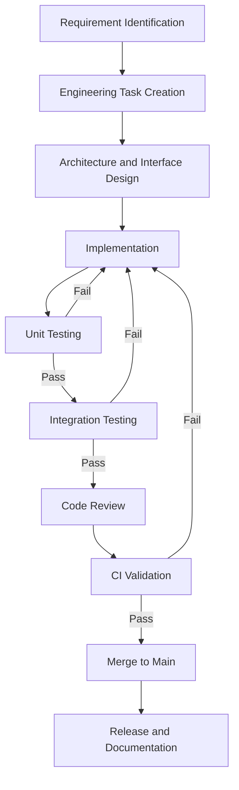
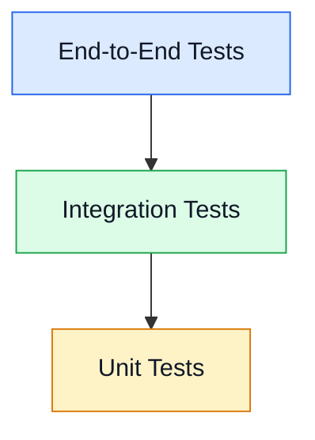
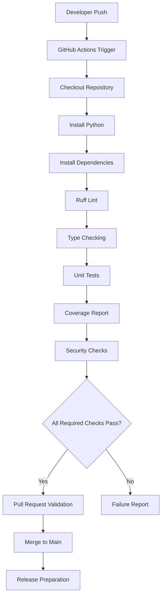
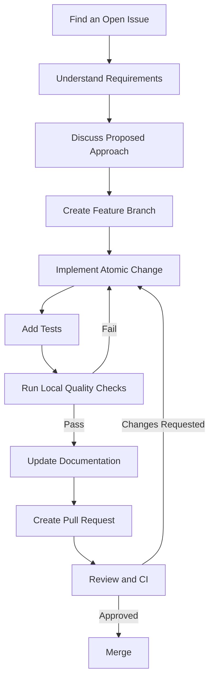

# ClawBot Agent — Development Engineering Handbook

**Document ID:** CLAW-DOC-002  
**Version:** 1.0.0  
**Document Type:** Software Development and Engineering Specification  
**Project:** ClawBot Agent  
**Primary Language:** Python  
**Build and Package Management:** Python Packaging Standards  
**Architecture:** Modular, Local-First Agent Runtime  
**Orchestration:** OpenClaw Integration  
**Development Model:** Iterative, Test-Driven and Milestone-Based  
**Source Control:** Git and GitHub  
**Automation:** GitHub Actions  

---

# 1. Introduction

## 1.1 Purpose

This document establishes the development methodology, engineering standards, repository conventions, testing practices and contribution workflow for ClawBot Agent.

It defines how the project should be developed, modified, tested, reviewed and released.

The objective is to ensure that every development activity is:

- Traceable.
- Reproducible.
- Testable.
- Maintainable.
- Documented.
- Independently reviewable.
- Compatible with the overall system architecture.

This document is intended for the primary developer, future contributors, maintainers and engineers extending the platform.

## 1.2 Development Philosophy

ClawBot follows an incremental engineering approach.

Instead of implementing the entire system as one large application, development is divided into independently testable subsystems.

Each subsystem should have:

1. A clearly defined responsibility.
2. An explicit interface.
3. A documented dependency relationship.
4. A testable implementation.
5. A defined acceptance criterion.
6. A traceable development identifier.

The development process should prioritize correctness and maintainability over unnecessary complexity.

## 1.3 Engineering Objectives

The development process aims to achieve:

| Objective | Expected outcome |
|---|---|
| Reproducibility | Developers can recreate the development environment. |
| Modularity | Components can be developed independently. |
| Testability | Modules can be validated without running the complete application. |
| Traceability | Changes can be mapped to engineering requirements. |
| Reliability | Failures are detected and handled predictably. |
| Security | Sensitive operations follow defined authorization policies. |
| Portability | Platform-specific dependencies remain isolated. |
| Maintainability | Code and documentation evolve together. |
| Extensibility | New providers and capabilities can be integrated without redesigning the entire system. |

---

# 2. Development Environment

## 2.1 Supported Development Platforms

The development environment should support the following operating systems:

| Platform | Development target |
|---|---|
| Windows 10/11 | Primary development environment |
| Ubuntu Linux | Linux development and testing |
| macOS | Desktop development |
| NVIDIA Jetson Linux | Edge deployment development |
| Raspberry Pi OS | Lightweight edge deployment development |

Platform compatibility must be validated rather than assumed.

## 2.2 Required Software

| Software | Purpose |
|---|---|
| Python 3.11+ | Application development |
| Git | Source control |
| GitHub | Repository and collaboration |
| VS Code | Development environment |
| pip | Python package installation |
| venv | Environment isolation |
| pytest | Automated testing |
| Ruff | Linting and formatting |
| mypy | Static type checking |
| GitHub Actions | CI automation |
| OpenClaw | Intended orchestration backend |
| Ollama | Optional local model runtime |

The supported Python version range must ultimately be synchronized with `pyproject.toml` and CI configuration.

## 2.3 Repository Acquisition

Clone the repository:

```bash
git clone https://github.com/Achyut0617/clawbot_agent.git
```

Enter the repository:

```bash
cd clawbot_agent
```

Create a development branch:

```bash
git switch -c feat/development-task
```

## 2.4 Virtual Environment

A virtual environment isolates project dependencies from the global Python installation.

### Windows

```powershell
py -3 -m venv .venv

.venv\Scripts\Activate.ps1
```

### Linux / macOS

```bash
python3 -m venv .venv

source .venv/bin/activate
```

Verify Python:

```bash
python --version
```

Verify pip:

```bash
python -m pip --version
```

## 2.5 Dependency Installation

Install the project in editable mode:

```bash
python -m pip install --upgrade pip

python -m pip install -e ".[dev]"
```

The development dependency group should be defined in `pyproject.toml`.

Editable installation allows changes to the source code to be tested without repeatedly reinstalling the application.

If optional audio dependencies are introduced, they should be installed through an explicitly documented optional dependency group.

For example:

```bash
python -m pip install -e ".[audio]"
```

The actual dependency groups must match those declared by the project.

---

# 3. Repository Engineering Structure

## 3.1 Directory Organization

The repository follows a modular Python source layout.

```text
clawbot_agent/
│
├── .github/
│   └── workflows/
│
├── config/
│   └── settings.yaml
│
├── docs/
│
├── legacy/
│
├── models/
│
├── scripts/
│
├── src/
│   └── clawbot/
│       ├── __init__.py
│       ├── audio.py
│       ├── cli.py
│       ├── config.py
│       ├── models.py
│       ├── orchestrator.py
│       ├── runtime.py
│       ├── safety.py
│       └── store.py
│
├── tests/
│
├── .env.example
├── .gitignore
├── CHANGELOG.md
├── LICENSE
├── pyproject.toml
├── README.md
└── ROADMAP.yaml
```

## 3.2 Source Directory

The `src/` directory contains the actual application package.

This structure is preferable to placing application modules directly at the repository root because it helps prevent accidental imports from the development working directory.

### Module responsibilities

| Module | Responsibility |
|---|---|
| `cli.py` | Command-line interface and entry point |
| `runtime.py` | Application lifecycle and request coordination |
| `orchestrator.py` | Orchestration backend abstraction and integration |
| `audio.py` | Audio acquisition and speech interfaces |
| `safety.py` | Validation and permission enforcement |
| `store.py` | Persistent task and event storage |
| `models.py` | Shared data structures |
| `config.py` | Configuration loading and validation |
| `__init__.py` | Package initialization |

Each module should contain only the responsibilities assigned to it.

## 3.3 Documentation Directory

The `docs/` directory is the engineering knowledge base.

Documentation must be updated whenever a significant implementation change modifies:

- Architecture.
- Public interfaces.
- Configuration.
- Installation.
- Security boundaries.
- Execution behavior.
- Testing requirements.

Documentation should describe verified implementation behavior separately from future design objectives.

---

# 4. Software Development Lifecycle

## 4.1 Development Workflow

ClawBot uses an iterative development lifecycle.



## 4.2 Requirement Identification

Every new capability should begin with an identifiable requirement.

Example:

**Requirement:** The application must support text commands when a microphone is unavailable.

Requirement ID:

`REQ-VOICE-004`

Expected behavior:

- The runtime must not require microphone initialization to start.
- Text input must remain accessible.
- Audio failures must be reported.
- The request must enter the same execution pipeline as voice requests.

## 4.3 Engineering Task Creation

Requirements should be decomposed into small implementation tasks.

Example:

```text
REQ-VOICE-004
    |
    +-- VOICE-021: Add microphone availability detection
    |
    +-- VOICE-022: Separate audio initialization
    |
    +-- INPUT-013: Add text input adapter
    |
    +-- CORE-018: Normalize voice and text requests
    |
    +-- TEST-015: Test microphone failure fallback
```

Each task should have:

- Unique identifier.
- Description.
- Technical objective.
- Dependencies.
- Implementation location.
- Validation procedure.
- Completion criteria.

## 4.4 Design Before Implementation

Before introducing a new subsystem, determine:

1. What problem does it solve?
2. Which module owns the responsibility?
3. What are its inputs?
4. What are its outputs?
5. Which dependencies does it require?
6. How will it handle failure?
7. How will it be tested?
8. Does it introduce a security concern?

This avoids tightly coupled implementations.

---

# 5. Atomic Development and Traceability

## 5.1 Atomic Engineering Principle

Development should be divided into small, independently understandable changes.

An atomic task should ideally modify one logical capability.

For example, microphone detection and OpenClaw integration should not be combined into one large commit.

This improves:

- Code review.
- Debugging.
- Rollback.
- Regression identification.
- Contribution tracking.
- Release management.

## 5.2 Identifier Convention

ClawBot uses structured identifiers.

| Prefix | Domain |
|---|---|
| CORE | Core runtime |
| INPUT | Input processing |
| VOICE | Voice subsystem |
| ORCH | Orchestration |
| SAFE | Safety |
| EXEC | Execution |
| DATA | Persistence |
| INST | Installation |
| PLAT | Platform support |
| TEST | Testing |
| DOC | Documentation |
| CI | Continuous integration |
| REL | Release management |

Example:

```text
CORE-001
INPUT-001
VOICE-001
ORCH-001
SAFE-001
DATA-001
INST-001
TEST-001
DOC-001
CI-001
```

Identifiers should never be reused for unrelated work.

## 5.3 ROADMAP.yaml as Development Source of Truth

The `ROADMAP.yaml` file maintains the mapping between requirements, development tasks, dependencies and milestones.

An illustrative task entry:

```yaml
project:
  name: ClawBot Agent
  version: 0.2.0

milestones:
  - id: CORE-V2
    name: Modular Runtime
    status: in_progress

tasks:
  - id: CORE-001
    title: Establish modular runtime
    milestone: CORE-V2
    status: completed
    priority: critical
    dependencies: []
    files:
      - src/clawbot/runtime.py
      - src/clawbot/cli.py
    tests:
      - tests/test_orchestrator.py
    acceptance_criteria:
      - Runtime can be initialized
      - Request processing has a defined interface

  - id: INPUT-001
    title: Unified input normalization
    milestone: CORE-V2
    status: planned
    priority: high
    dependencies:
      - CORE-001
    files:
      - src/clawbot/models.py
    tests:
      - tests/test_input.py
    acceptance_criteria:
      - Voice and text requests use a common representation

  - id: ORCH-001
    title: OpenClaw adapter integration
    milestone: ORCH-V1
    status: planned
    priority: critical
    dependencies:
      - CORE-001
    files:
      - src/clawbot/orchestrator.py
    tests:
      - tests/test_orchestrator.py
    acceptance_criteria:
      - Backend connection can be validated
      - Backend errors are handled
      - Responses are validated before use
```

This example is a schema illustration. The actual roadmap must remain synchronized with real repository work.

## 5.4 Development State Definitions

| Status | Meaning |
|---|---|
| planned | Identified but not started |
| in_progress | Currently under development |
| blocked | Waiting for a dependency or decision |
| review | Implementation awaiting review |
| testing | Validation in progress |
| completed | Acceptance criteria satisfied |
| deferred | Intentionally postponed |

A task should not be marked completed merely because its source file exists.

---

# 6. Coding Standards

## 6.1 General Python Standards

ClawBot should follow modern Python engineering conventions.

Recommended standards:

- PEP 8 for code style.
- PEP 257 for docstrings.
- PEP 484 for type hints.
- PEP 526 for variable annotations.
- PEP 621 for project metadata.

## 6.2 Naming Conventions

| Element | Convention | Example |
|---|---|---|
| Module | snake_case | `runtime.py` |
| Function | snake_case | `submit_request()` |
| Variable | snake_case | `task_status` |
| Class | PascalCase | `AgentRuntime` |
| Constant | UPPER_SNAKE_CASE | `MAX_RETRIES` |
| Private helper | Leading underscore | `_validate_request()` |

Names should express intent rather than implementation details.

## 6.3 Type Annotations

Public functions should use type annotations.

Example:

```python
def validate_request(
    request: AgentRequest,
) -> ValidationResult:
    ...
```

Type annotations improve:

- Readability.
- Static analysis.
- IDE assistance.
- Interface clarity.
- Refactoring confidence.

Use structured data models instead of passing loosely defined dictionaries throughout the application.

## 6.4 Docstrings

Public classes and functions should document their purpose, arguments, return values and relevant exceptions.

Example:

```python
def submit_request(request: AgentRequest) -> TaskResult:
    """
    Submit a normalized request to the agent runtime.

    Args:
        request: Validated user request.

    Returns:
        Structured task execution result.

    Raises:
        RequestValidationError: If the request is invalid.
        OrchestrationError: If orchestration fails.
    """
```

## 6.5 Error Handling

Avoid broad exception suppression.

Bad practice:

```python
try:
    execute_task()
except Exception:
    pass
```

Preferred approach:

```python
try:
    execute_task()

except ConnectionError as exc:
    logger.error(
        "Orchestration connection failed",
        exc_info=exc,
    )
    raise OrchestrationError(
        "Unable to contact orchestration backend"
    ) from exc
```

Exceptions should be translated into meaningful application-level errors where appropriate.

Do not expose secrets or sensitive internal information in user-facing errors.

---

# 7. Configuration Management

## 7.1 Configuration Philosophy

Configuration must be separated from application logic.

The project should support:

1. Default configuration.
2. YAML-based application settings.
3. Environment variables for sensitive or deployment-specific values.
4. Explicit runtime overrides where required.

The application should define a predictable configuration precedence.

Recommended order:

```text
Runtime overrides
       |
       v
Environment variables
       |
       v
Configuration file
       |
       v
Application defaults
```

## 7.2 Configuration Categories

| Category | Example |
|---|---|
| Runtime | Log level, application mode |
| Audio | Input device, sample rate |
| Speech | Recognition provider |
| Orchestration | Backend address, timeout |
| Storage | Database location |
| Safety | Permission policies |
| Execution | Timeout and retry limits |

## 7.3 Secret Management

Secrets must never be committed to Git.

Examples include:

- API keys.
- Access tokens.
- Passwords.
- Private service credentials.

Use `.env` locally where required, and provide `.env.example` containing placeholder names only.

Production deployments should use an appropriate secret-management mechanism.

---

# 8. Testing Engineering Standards

## 8.1 Testing Philosophy

Testing is part of implementation, not a separate activity performed only before release.

Every meaningful feature should have a corresponding validation strategy.

ClawBot should adopt a layered testing approach.

## 8.2 Testing Pyramid



### Unit Testing

Validates individual functions and modules.

Examples:

- Configuration parsing.
- Request normalization.
- Permission validation.
- Task state transitions.
- Database operations.

### Integration Testing

Validates communication between multiple components.

Examples:

- Runtime and task store.
- Runtime and OpenClaw adapter.
- Safety policy and capability registry.
- Voice recognition and input normalization.

### End-to-End Testing

Validates a complete user interaction.

Example:

```text
User submits text
       |
       v
Runtime receives request
       |
       v
Orchestration generates plan
       |
       v
Safety validates plan
       |
       v
Executor performs approved operation
       |
       v
Task result is persisted
       |
       v
User receives response
```

## 8.3 Test Framework

Use pytest for automated tests.

Install:

```bash
python -m pip install pytest pytest-cov
```

Run tests:

```bash
python -m pytest
```

Generate coverage:

```bash
python -m pytest --cov=clawbot --cov-report=term-missing
```

Coverage is a measurement of executed code, not proof of correctness.

Critical security and execution paths must receive explicit behavioral tests.

## 8.4 Test Isolation

Tests should not unnecessarily depend on:

- A physical microphone.
- A GPU.
- A running Ollama server.
- An external OpenClaw installation.
- Internet access.
- Physical robot hardware.

Use dependency injection, mocks and controlled test fixtures where appropriate.

For example, orchestration integration tests should use a fake backend unless a dedicated integration environment is available.

## 8.5 Required Test Categories

| Test ID | Category | Validation |
|---|---|---|
| TEST-001 | Runtime | Runtime initialization |
| TEST-002 | Input | Text request normalization |
| TEST-003 | Input | Voice request normalization |
| TEST-004 | Voice | Missing microphone fallback |
| TEST-005 | Orchestration | Backend connection failure |
| TEST-006 | Orchestration | Invalid response handling |
| TEST-007 | Safety | Unauthorized action rejection |
| TEST-008 | Safety | Approval enforcement |
| TEST-009 | Storage | Task persistence |
| TEST-010 | Storage | Event history |
| TEST-011 | Recovery | Retry and cancellation |
| TEST-012 | Installation | Environment validation |
| TEST-013 | Portability | Platform-specific behavior |

---

# 9. Static Analysis and Code Quality

## 9.1 Ruff

Ruff provides Python linting and formatting.

Install:

```bash
python -m pip install ruff
```

Check code:

```bash
ruff check .
```

Format code:

```bash
ruff format .
```

## 9.2 Mypy

Mypy provides static type checking.

Install:

```bash
python -m pip install mypy
```

Run:

```bash
mypy src/
```

Static checking should be introduced progressively and configured against the actual dependency and typing requirements.

## 9.3 Quality Gates

Before merging a feature, the following checks should be considered:

| Quality gate | Requirement |
|---|---|
| Syntax | No syntax errors |
| Formatting | Consistent formatting |
| Linting | No unresolved critical lint issues |
| Type checking | No unresolved required type errors |
| Unit tests | All required tests pass |
| Integration tests | Relevant component contracts pass |
| Security | No exposed secrets or unauthorized execution path |
| Documentation | Relevant documentation is updated |

---

# 10. Git and Contribution Workflow

## 10.1 Branching Strategy

The project follows a feature-branch workflow.

```text
main
 |
 +-- feat/unified-input
 |
 +-- feat/openclaw-adapter
 |
 +-- feat/voice-fallback
 |
 +-- fix/task-state-transition
 |
 +-- docs/system-design
```

The `main` branch should contain reviewed and validated changes.

Avoid directly committing incomplete features to `main`.

## 10.2 Branch Naming Convention

| Prefix | Purpose |
|---|---|
| feat/ | New functionality |
| fix/ | Bug fixes |
| docs/ | Documentation |
| test/ | Test improvements |
| refactor/ | Internal restructuring |
| ci/ | CI/CD modifications |
| chore/ | Maintenance |

Examples:

```bash
git switch -c feat/openclaw-adapter

git switch -c feat/text-fallback

git switch -c fix/audio-initialization

git switch -c docs/orchestration-design
```

## 10.3 Atomic Commit Convention

Use Conventional Commits.

Format:

```text
<type>(<scope>): <description>
```

Examples:

```text
feat(INPUT-001): introduce unified request normalization

feat(ORCH-001): add OpenClaw adapter interface

fix(VOICE-004): handle missing microphone gracefully

test(SAFE-002): add unauthorized action rejection tests

docs(DOC-002): document development engineering workflow

ci(CI-001): introduce automated Python validation
```

Each commit should represent one logical change.

## 10.4 Pull Request Workflow

Every feature should pass through a reviewable pull request.

Required information:

- Related issue or task identifier.
- Problem statement.
- Technical implementation.
- Modified files.
- Testing performed.
- Configuration changes.
- Security implications.
- Documentation changes.

A pull request should not be merged merely because it compiles.

It should satisfy the associated acceptance criteria.

## 10.5 Change Review

Reviewers should check:

1. Does the change solve the stated problem?
2. Does it respect module responsibilities?
3. Does it introduce unnecessary dependencies?
4. Are error cases handled?
5. Are security boundaries preserved?
6. Are tests meaningful?
7. Is documentation accurate?
8. Is the change sufficiently small to review?

---

# 11. Continuous Integration and Delivery

## 11.1 CI/CD Philosophy

Continuous Integration and Continuous Delivery automate the validation and distribution lifecycle.

CI verifies that changes meet the project's engineering standards.

CD prepares validated software for controlled release.

The pipeline should not automatically execute unsafe operations or deploy unreviewed changes to physical hardware.

## 11.2 CI Pipeline



## 11.3 Continuous Integration Checks

The CI workflow should progressively include:

- Supported Python version matrix.
- Dependency installation.
- Ruff linting.
- Ruff formatting verification.
- Mypy checks.
- Pytest.
- Coverage reporting.
- Dependency vulnerability scanning.
- Package build validation.

The exact checks should be aligned with the current `pyproject.toml`.

## 11.4 Continuous Delivery

The release workflow should:

1. Validate the selected release version.
2. Run required automated tests.
3. Build the Python distribution.
4. Validate package metadata.
5. Generate release artifacts.
6. Publish a GitHub Release.
7. Publish to a package registry only after explicit release authorization.

## 11.5 Release Versioning

ClawBot should follow Semantic Versioning.

Format:

```text
MAJOR.MINOR.PATCH
```

Example:

| Version | Meaning |
|---|---|
| 0.1.0 | Initial development release |
| 0.2.0 | New compatible functionality |
| 0.2.1 | Bug fix |
| 0.3.0 | Additional compatible capabilities |
| 1.0.0 | First stable public release |

Breaking changes should increment the major version once the project reaches an appropriate release maturity.

---

# 12. Dependency and Package Management

## 12.1 Dependency Principles

Dependencies should be introduced only when they provide meaningful functionality.

Every dependency should have:

- A clear purpose.
- A compatible license.
- A maintained release history.
- A documented version policy.
- A known security profile.

Avoid installing large AI frameworks when a smaller library can solve the requirement.

## 12.2 Dependency Categories

| Category | Examples |
|---|---|
| Runtime | Python standard library |
| Configuration | PyYAML, Pydantic |
| Audio | Vosk, sounddevice |
| Persistence | SQLite |
| Orchestration | OpenClaw integration interface |
| Testing | pytest |
| Quality | Ruff, mypy |
| Security | Bandit, dependency scanners |
| Packaging | build |

These are candidate technologies. Only dependencies declared in the actual package configuration should be considered installed project dependencies.

## 12.3 Dependency Updates

Dependency updates should be controlled.

Recommended procedure:

1. Identify the dependency and reason for updating.
2. Check compatibility.
3. Update the package constraint.
4. Run unit tests.
5. Run integration tests.
6. Review security advisories.
7. Update documentation if behavior changes.
8. Commit the update separately.

---

# 13. Debugging and Diagnostics

## 13.1 Logging Standards

The application should use structured logging rather than uncontrolled print statements in production code.

Recommended log levels:

| Level | Purpose |
|---|---|
| DEBUG | Detailed development information |
| INFO | Normal lifecycle events |
| WARNING | Recoverable abnormal conditions |
| ERROR | Failed operations |
| CRITICAL | Application-level critical failures |

## 13.2 Correlation Identifiers

Each request should have an identifier that can be used to correlate related log events.

Example:

```text
2026-11-17 10:15:30 INFO
task_id=task-001
component=runtime
event=request_received
source=text
```

This makes it easier to follow a request across multiple subsystems.

## 13.3 Debugging Procedure

When a feature fails:

1. Reproduce the failure.
2. Identify the affected subsystem.
3. Inspect structured logs.
4. Check configuration.
5. Isolate external dependencies.
6. Create a minimal test case.
7. Implement the fix.
8. Add a regression test.
9. Verify related functionality.
10. Update the development record.

A bug fix should include a regression test wherever practical.

---

# 14. Engineering Documentation Standards

## 14.1 Documentation as Part of Development

Documentation is a maintained engineering artifact.

It should evolve with the implementation.

A feature is not considered fully documented until its:

- Purpose.
- Interfaces.
- Configuration.
- Dependencies.
- Failure behavior.
- Security implications.
- Testing requirements.

are documented appropriately.

## 14.2 Documentation Naming

Use descriptive Markdown filenames.

Examples:

```text
ARCHITECTURE.md
DEVELOPMENT.md
SECURITY.md
SYSTEM_DESIGN.md
VOICE_AND_INTERACTION.md
ORCHESTRATION.md
INSTALLATION_AND_DEPLOYMENT.md
TESTING_AND_VALIDATION.md
ROADMAP_AND_RELEASES.md
REFERENCES.md
```

## 14.3 Documentation Review

Before merging documentation:

- Verify technical terminology.
- Verify code examples.
- Verify paths and filenames.
- Verify diagrams.
- Distinguish current implementation from future plans.
- Update references when APIs change.

---

# 15. Contributor Workflow

## 15.1 Contribution Lifecycle



## 15.2 Definition of Ready

A development task is ready when:

- The requirement is clear.
- Its expected behavior is defined.
- Dependencies are identified.
- The implementation scope is understood.
- Acceptance criteria are available.

## 15.3 Definition of Done

A development task is complete when:

- The implementation satisfies its requirements.
- Relevant tests pass.
- Errors are handled.
- Security constraints are respected.
- Documentation is updated.
- Changes are committed.
- CI checks pass.
- The corresponding task is updated.

---

# 16. Development Roadmap Mapping

The development process should follow these engineering workstreams.

| Workstream | Scope | Milestone |
|---|---|---|
| CORE | Runtime and lifecycle | CORE-V2 |
| INPUT | Unified input system | INPUT-V1 |
| VOICE | Speech interaction | VOICE-V1 |
| ORCH | OpenClaw integration | ORCH-V1 |
| SAFE | Policy and permissions | SAFE-V1 |
| EXEC | Capability execution | EXEC-V1 |
| DATA | Task persistence | DATA-V1 |
| INST | Installation management | INST-V1 |
| PLAT | Cross-platform validation | PLAT-V1 |
| TEST | Test infrastructure | TEST-V1 |
| CI | Automated workflows | CI-V1 |
| DOC | Engineering documentation | DOC-V1 |
| REL | Release management | REL-V1 |

The `ROADMAP.yaml` file should track individual tasks and their actual implementation status.

---

# 17. Engineering Maturity Criteria

ClawBot should progress through defined maturity levels.

## Level 1 — Functional Prototype

- Basic command processing.
- Initial voice interaction.
- Basic model integration.
- Simulation-based execution.

## Level 2 — Modular Runtime

- Separated application modules.
- Unified request representation.
- Defined task lifecycle.
- Persistent task records.
- Independent safety validation.

## Level 3 — Integrated Agent

- Verified OpenClaw integration.
- Structured tool coordination.
- Text and voice interfaces.
- Error recovery.
- Approval mechanisms.

## Level 4 — Portable Agent Platform

- Cross-platform installation.
- Platform-specific validation.
- Configurable model providers.
- Robust task persistence.
- Automated release pipeline.

## Level 5 — Advanced Agent Infrastructure

- Long-running task coordination.
- Multiple capability providers.
- Multi-agent delegation.
- Advanced observability.
- Device-to-device coordination.
- Secure remote execution.

A maturity level should only be awarded after its acceptance criteria have been validated.

---

# 18. Conclusion

The development methodology defined in this document establishes a disciplined engineering process for ClawBot Agent.

The project should be developed through small, traceable and independently testable changes.

Every feature should have a defined requirement, an implementation owner, a test strategy and an acceptance criterion.

The combination of modular Python development, automated validation, structured task tracking, documented interfaces and controlled releases provides the foundation for long-term project maintainability.

The objective is not merely to make ClawBot functional.

The objective is to establish an engineering platform that can be understood, extended, tested, deployed and maintained by multiple developers across different environments.

**Development principle: Every implementation must be explainable, every important behavior must be testable, and every engineering change must be traceable.**

---

# 19. References

1. ClawBot Agent Repository: https://github.com/Achyut0617/clawbot_agent
2. Python Documentation: https://docs.python.org/3/
3. Python Packaging User Guide: https://packaging.python.org/
4. Python PEP Index: https://peps.python.org/
5. pytest Documentation: https://docs.pytest.org/
6. Ruff Documentation: https://docs.astral.sh/ruff/
7. Mypy Documentation: https://mypy.readthedocs.io/
8. Conventional Commits: https://www.conventionalcommits.org/
9. Semantic Versioning: https://semver.org/
10. Git Documentation: https://git-scm.com/doc
11. GitHub Actions: https://docs.github.com/en/actions
12. OpenClaw Repository: https://github.com/openclaw/openclaw

---

**Document Maintenance**

| Attribute | Value |
|---|---|
| Document ID | CLAW-DOC-002 |
| Version | 1.0.0 |
| Owner | ClawBot Agent Development |
| Review frequency | On significant development-process changes |
| Related documents | ARCHITECTURE.md, SECURITY.md, SYSTEM_DESIGN.md, TESTING_AND_VALIDATION.md |

**End of Document — CLAW-DOC-002**
