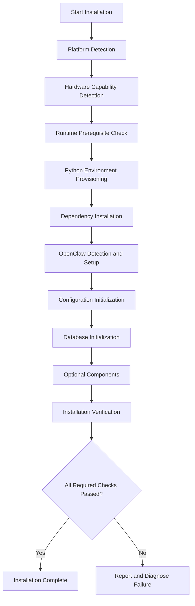
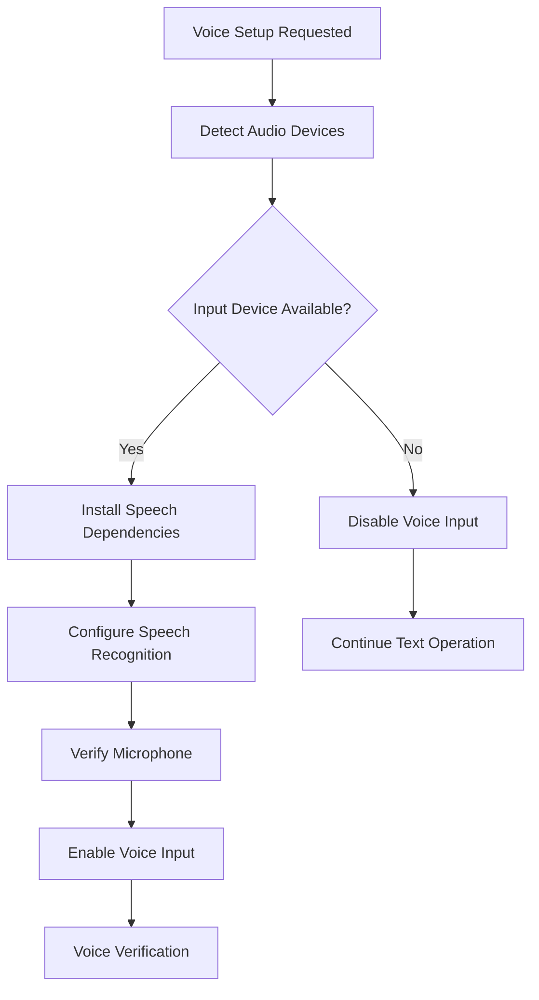

# Installation and Provisioning Specification

**Document ID:** `CB-DOC-006`  
**File:** `docs/INSTALLATION.md`  
**Project:** ClawBot Agent  
**Status:** Engineering Specification  
**Version:** 1.0.0  
**Scope:** Cross-platform installation, provisioning, verification, upgrades, rollback, and removal

---

## 1. Purpose

This document defines the installation and provisioning architecture for ClawBot.

The installation system must provide a consistent, reproducible, and verifiable setup process across supported operating systems and hardware platforms.

The installer is responsible for preparing the environment in which ClawBot operates. It must not tightly couple the core runtime to optional hardware, operating-system services, or acceleration frameworks.

### 1.1 Primary objectives

- Support installation across Windows, Linux, macOS, Raspberry Pi, and NVIDIA Jetson.
- Detect operating-system and hardware capabilities before provisioning.
- Create and configure an isolated Python environment.
- Install and verify required application dependencies.
- Detect and configure the OpenClaw orchestration backend.
- Support optional voice input and speech output.
- Support optional local model integration.
- Initialize application configuration and SQLite persistence.
- Verify installation through automated health checks.
- Support upgrades, rollback, and clean uninstallation.
- Preserve text-based operation when optional components are unavailable.

### 1.2 Non-objectives

The installer must not:

- Assume every hardware platform supports every feature.
- Automatically install GPU drivers or modify system-level drivers without explicit authorization.
- Store API keys or passwords in source-controlled configuration.
- Require microphone access to launch the application.
- Execute arbitrary downloaded installation scripts without validation.
- Treat successful dependency installation as proof of a working system.
- Assume OpenClaw provides undocumented interfaces or APIs.

---

## 2. Installation Architecture

ClawBot installation is divided into independent provisioning stages.



### 2.1 Provisioning layers

| Layer | Responsibility | Required |
|---|---|---|
| Platform detection | Identify OS, architecture, and environment | Yes |
| Hardware detection | Identify CPU, RAM, GPU, and available devices | Yes |
| Runtime provisioning | Prepare Python environment | Yes |
| Dependency installation | Install application dependencies | Yes |
| Orchestration setup | Detect and configure OpenClaw | Yes |
| Configuration | Initialize YAML configuration | Yes |
| Persistence | Initialize SQLite database | Yes |
| Voice setup | Configure speech input/output | No |
| Local model setup | Configure local inference backend | No |
| GPU acceleration | Configure supported acceleration | No |
| Verification | Execute installation health checks | Yes |

### 2.2 Core installation principle

The installation system must distinguish between:

- **Required components:** Needed for the minimum supported ClawBot runtime.
- **Optional components:** Improve functionality but are not necessary for basic operation.
- **Platform-specific components:** Depend on operating-system or hardware capabilities.

Failure to provision an optional component must not invalidate the installation.

---

## 3. Supported Platforms

### 3.1 Target platform matrix

| Platform | Architecture | Priority | Installation strategy |
|---|---|---|---|
| Windows 10/11 | x86-64 | Primary | PowerShell bootstrapper |
| Ubuntu Linux | x86-64 | High | Shell-based bootstrapper |
| Debian Linux | ARM64/x86-64 | High | Shell-based bootstrapper |
| macOS | ARM64/x86-64 | Medium | Shell-based bootstrapper |
| Raspberry Pi OS | ARM64 | High | Resource-aware installation |
| NVIDIA Jetson | ARM64 | High | Jetson-compatible dependency profile |

The platform matrix represents intended targets, not a claim that every feature is already supported on every platform.

Each release must publish its verified compatibility matrix.

### 3.2 Platform detection requirements

The installer must identify:

- Operating-system name.
- Operating-system version.
- CPU architecture.
- Python availability and version.
- Available memory.
- Available disk space.
- GPU availability, where detectable.
- Audio input/output device availability.
- Network connectivity.
- Existing OpenClaw installation.
- Existing ClawBot installation.

### 3.3 Platform detection output

The detection module should produce a structured report.

Example:

```json
{
  "platform": {
    "os": "Windows",
    "version": "11",
    "architecture": "x86_64"
  },
  "runtime": {
    "python_available": true,
    "python_version": "3.x"
  },
  "hardware": {
    "cpu_available": true,
    "gpu_available": true,
    "memory_available": true
  },
  "capabilities": {
    "voice_input": false,
    "voice_output": false,
    "local_inference": true
  }
}
```

This is an illustrative output schema. Actual values must be obtained from runtime detection.

---

## 4. Hardware and Resource Profiles

ClawBot must use resource-aware installation profiles.

### 4.1 Profiles

| Profile | Target | Expected behavior |
|---|---|---|
| `desktop` | Windows/Linux/macOS workstation | Full supported application features |
| `lightweight` | Low-memory computers | Minimal dependencies and reduced background services |
| `raspberry_pi` | Raspberry Pi | ARM-compatible packages and lightweight execution |
| `jetson` | NVIDIA Jetson | Jetson-compatible libraries and optional GPU acceleration |
| `headless` | Server or embedded device | No GUI or mandatory audio dependency |

### 4.2 Resource detection

The installer should detect:

- Total and available RAM.
- CPU core count.
- Architecture.
- GPU model and memory, when available.
- Available disk space.
- Storage write permissions.

### 4.3 Resource-aware behavior

The installer should use detected capabilities to recommend:

- Whether local model inference is practical.
- Whether GPU acceleration is supported.
- Whether voice processing should be enabled.
- Whether a lightweight configuration is appropriate.
- Whether background services should be disabled.

Resource detection must not automatically authorize system-level hardware modifications.

---

## 5. Runtime Prerequisites

### 5.1 Python runtime

The project must define its supported Python version range in:

- `pyproject.toml`
- Dependency lock file
- CI configuration
- Installation documentation

The installer must verify that the available Python interpreter satisfies the declared version requirement.

Do not hardcode an unverified Python version in the installer.

### 5.2 Python environment isolation

ClawBot must use an isolated environment.

Recommended development setup:

**Windows**

```powershell
python -m venv .venv
.venv\Scripts\Activate.ps1
```

**Linux/macOS**

```bash
python3 -m venv .venv
source .venv/bin/activate
```

### 5.3 Dependency management

Dependencies must be separated by functionality.

Recommended organization:

```text
dependencies/
    core.txt
    voice.txt
    local-models.txt
    gpu.txt
    development.txt
```

The actual dependency management strategy must remain consistent with the project's package metadata and lock file.

Core dependencies must not unnecessarily include heavy machine-learning frameworks.

### 5.4 Dependency installation

Core installation:

```bash
python -m pip install --upgrade pip
python -m pip install -e .
```

Optional development dependencies:

```bash
python -m pip install -e ".[dev]"
```

Optional extras such as voice, GPU acceleration, and local inference must only be installed when supported and requested.

These commands are illustrative until the corresponding package extras are defined.

---

## 6. OpenClaw Provisioning

OpenClaw is the orchestration backend for ClawBot.

ClawBot is responsible for its own application lifecycle, interfaces, capability registry, security policies, and execution controls.

OpenClaw is responsible for orchestration through its supported and verified integration interface.

### 6.1 Provisioning requirements

The installation system must:

1. Detect whether OpenClaw is already installed.
2. Determine the installed version.
3. Check compatibility with the ClawBot integration.
4. Detect whether its required service or Gateway is reachable.
5. Guide the user through installation if missing.
6. Verify connectivity using the documented interface.
7. Store non-secret connection configuration.
8. Validate authentication and permissions.

### 6.2 Installation safety

The installer must use official OpenClaw installation instructions and supported interfaces.

It must not assume undocumented Python imports, internal classes, or communication protocols.

OpenClaw installation must not silently overwrite an existing installation.

### 6.3 Backend verification

The installer must distinguish between:

- OpenClaw not installed.
- OpenClaw installed but not running.
- Gateway unreachable.
- Authentication failure.
- Version incompatibility.
- Successful connection.

A successful installation of OpenClaw does not automatically mean that ClawBot integration is operational.

---

## 7. Configuration Initialization

### 7.1 Configuration directory

Recommended application structure:

```text
clawbot/
    config/
        config.yaml
        capabilities.yaml
        logging.yaml
    data/
        clawbot.db
    logs/
    models/
    cache/
```

The actual locations should follow operating-system conventions for application data and configuration.

Development-mode paths may remain inside the repository.

### 7.2 Configuration initialization

On first launch, ClawBot must:

1. Check whether the configuration directory exists.
2. Create required directories.
3. Load the default configuration.
4. Validate the configuration schema.
5. Create missing configuration files.
6. Preserve existing user configuration.
7. Identify missing required settings.
8. Report optional configuration gaps.

### 7.3 Example configuration

```yaml
application:
  name: clawbot
  environment: development
  log_level: INFO

runtime:
  interface:
    text: true
    voice: false

  execution:
    approval_required: true
    allow_unknown_capabilities: false

orchestration:
  backend: openclaw
  enabled: true
  connection_timeout_seconds: 10

voice:
  enabled: false
  input:
    enabled: false
  output:
    enabled: false

models:
  local_inference:
    enabled: false

storage:
  backend: sqlite
  database_path: data/clawbot.db
```

This configuration is a starting contract. The implementation must validate it against a versioned configuration schema.

### 7.4 Secret management

Secrets must never be committed to Git.

Examples include:

- API keys.
- Gateway authentication tokens.
- Cloud credentials.
- Model provider credentials.

Use environment variables or an appropriate operating-system secret store.

A committed `.env.example` may contain placeholder values only.

---

## 8. Database Provisioning

SQLite is the initial persistence backend.

### 8.1 Initialization requirements

The installation process must:

- Create the database directory.
- Initialize the SQLite database.
- Apply schema migrations.
- Validate database accessibility.
- Check read/write permissions.
- Preserve existing database contents during upgrades.

### 8.2 Database migration

Database changes must use versioned migrations.

Example migration metadata:

```text
migration_id: DB-MIG-001
description: Initial application schema
version: 1
```

The installer must never delete the existing database simply because schema initialization fails.

Database backup must be performed before potentially destructive migrations.

---

## 9. Optional Voice Installation

Voice is an optional interface.

The application must remain fully usable through text commands when voice functionality is unavailable.

### 9.1 Voice installation stages



### 9.2 Voice input

The voice module may require:

- Audio input device.
- Microphone permission.
- Speech recognition engine.
- Audio-processing dependencies.

The installer must not assume that microphone hardware or permissions are available.

### 9.3 Speech output

Text-to-speech functionality must be independently configurable.

A missing TTS engine must not disable speech recognition or text interaction.

### 9.4 Failure handling

| Failure | Required behavior |
|---|---|
| Microphone unavailable | Disable voice input |
| Permission denied | Report permission issue |
| Speech engine missing | Keep text mode active |
| TTS engine missing | Disable speech output |
| Audio driver error | Log diagnostic information |
| Audio device disconnected | Continue through text interface |

---

## 10. Local Model Provisioning

Local model support is optional.

The installer must not download large model weights automatically without explicit user consent.

### 10.1 Model provisioning requirements

- Detect available storage.
- Detect available memory.
- Identify supported inference backends.
- Check model compatibility.
- Verify model file integrity.
- Record model metadata.
- Provide a clear download and setup process.

### 10.2 Model metadata

Example:

```yaml
model:
  id: local-model-001
  name: example-model
  backend: ollama
  location: models/
  quantization: unknown
  enabled: false
```

The model configuration must reflect the actual model and backend selected by the user.

### 10.3 GPU acceleration

GPU acceleration must be optional.

The installer must not assume that CUDA, TensorRT, or another acceleration framework is installed merely because an NVIDIA GPU is detected.

GPU compatibility must be verified against the operating system, hardware, driver, runtime, and framework versions.

---

## 11. Installation Verification

Installation is complete only after required verification checks pass.

### 11.1 Verification checklist

| ID | Verification | Expected result |
|---|---|---|
| `INS-VER-001` | Python runtime | Supported version detected |
| `INS-VER-002` | Environment | Isolated environment available |
| `INS-VER-003` | Core dependencies | Import checks pass |
| `INS-VER-004` | Configuration | Schema validation passes |
| `INS-VER-005` | SQLite | Database accessible |
| `INS-VER-006` | OpenClaw | Backend integration verified |
| `INS-VER-007` | Text interface | Basic text request works |
| `INS-VER-008` | Voice interface | Optional capability status reported |
| `INS-VER-009` | Security | No secrets exposed in logs |
| `INS-VER-010` | Diagnostics | Installation report generated |

### 11.2 Smoke test

The installation must support a basic smoke test.

Example:

```bash
clawbot doctor
```

Expected checks:

```text
[PASS] Platform detection
[PASS] Python runtime
[PASS] Core dependencies
[PASS] Configuration validation
[PASS] SQLite connectivity
[PASS] Text interface
[WARN] Voice input unavailable
[WARN] Local inference not configured
[PASS] Security configuration
```

The output is illustrative. Actual command names must match the implemented CLI.

### 11.3 Installation report

Generate a diagnostic report containing:

- Application version.
- Installer version.
- Platform details.
- Python version.
- Dependency verification status.
- OpenClaw connectivity status.
- Database status.
- Optional feature status.
- Failed verification checks.

The report must exclude credentials, access tokens, and other secrets.

---

## 12. Upgrade Strategy

ClawBot must support controlled upgrades.

### 12.1 Upgrade stages

1. Detect current installation.
2. Identify the current application version.
3. Check compatibility with the target version.
4. Back up user configuration.
5. Back up the database.
6. Apply dependency updates.
7. Apply database migrations.
8. Run verification checks.
9. Confirm successful upgrade.

### 12.2 Configuration preservation

Upgrades must preserve:

- User configuration.
- Capability preferences.
- User-defined settings.
- Database records.
- Local model references.
- Environment-specific settings.

Default configuration changes must not silently overwrite user modifications.

### 12.3 Rollback

If an upgrade fails:

- Preserve the failure logs.
- Restore the previous application version where supported.
- Restore compatible configuration and database backups.
- Report the rollback result.
- Avoid deleting user data.

Database rollback must be explicitly designed and tested; restoring an application binary alone is insufficient.

---

## 13. Uninstallation

Uninstallation must be explicit and predictable.

### 13.1 Removal categories

| Category | Description |
|---|---|
| Application files | ClawBot application files |
| Virtual environment | Isolated Python environment |
| Configuration | User configuration |
| Database | Persistent application data |
| Logs | Application logs |
| Models | Downloaded local models |
| Cache | Temporary application data |

### 13.2 Safe removal policy

The uninstaller must distinguish between application files and user data.

User configuration, databases, and downloaded models should be preserved by default unless the user explicitly requests complete removal.

### 13.3 Uninstallation verification

The uninstaller must verify:

- Application files removed.
- Virtual environment removed when requested.
- Services or processes stopped when applicable.
- User data preserved or removed according to the selected policy.
- No unintended system-level changes made.

---

## 14. Offline Installation

ClawBot should support offline installation where practical.

### 14.1 Requirements

- Pre-downloaded dependency packages.
- Version-controlled installation manifests.
- Local package cache.
- Verified package integrity.
- Clear missing-dependency reporting.
- No mandatory cloud connectivity for basic local text functionality, where the selected backend permits it.

### 14.2 Offline limitations

OpenClaw connectivity, cloud-based model providers, and remote services may require network access.

The installer must clearly identify which features require connectivity.

It must not report a complete online integration when only local installation has been verified.

---

## 15. Installation Logging and Diagnostics

All provisioning stages must generate structured logs.

### 15.1 Required log fields

```json
{
  "timestamp": "ISO-8601",
  "event_id": "INS-EVT-001",
  "component": "dependency_installer",
  "severity": "INFO",
  "operation": "verify_dependency",
  "status": "success"
}
```

### 15.2 Logging requirements

- Use consistent severity levels.
- Record installation stage identifiers.
- Include actionable error messages.
- Avoid logging secrets.
- Preserve logs when installation fails.
- Support diagnostic export.

---

## 16. Automated Installation Testing

Installation scripts must be tested independently from the core agent.

### 16.1 Test categories

| Test ID | Category | Description |
|---|---|---|
| `INS-TST-001` | Platform detection | Validate OS detection |
| `INS-TST-002` | Architecture detection | Validate CPU architecture |
| `INS-TST-003` | Python validation | Detect unsupported Python |
| `INS-TST-004` | Environment creation | Validate virtual environment |
| `INS-TST-005` | Dependency installation | Verify core dependency setup |
| `INS-TST-006` | Configuration | Validate default configuration |
| `INS-TST-007` | Database | Validate SQLite initialization |
| `INS-TST-008` | OpenClaw | Test mocked backend detection |
| `INS-TST-009` | Voice unavailable | Confirm text mode remains operational |
| `INS-TST-010` | Upgrade | Verify configuration preservation |
| `INS-TST-011` | Rollback | Verify recovery behavior |
| `INS-TST-012` | Uninstallation | Verify safe removal |
| `INS-TST-013` | Offline mode | Verify local package installation |

### 16.2 Testing principles

- Mock external services where appropriate.
- Never require a physical microphone in standard CI.
- Never require a GPU in standard CI.
- Test platform-specific logic independently.
- Test failure paths, not only successful installation.
- Use disposable environments for installation tests.
- Never run destructive uninstallation tests against the developer's real environment.

---

## 17. Installer Security Requirements

The installation system is part of the security boundary.

It must:

1. Validate downloaded package sources.
2. Avoid executing untrusted scripts.
3. Use trusted package repositories.
4. Verify package integrity where supported.
5. Avoid unnecessary administrator privileges.
6. Request elevated permissions only when necessary.
7. Never expose credentials in logs.
8. Never overwrite user configuration without authorization.
9. Avoid modifying system PATH or environment settings unnecessarily.
10. Require explicit approval for destructive cleanup.

---

## 18. Recommended Repository Structure

```text
clawbot_agent/
│
├── docs/
│   ├── ARCHITECTURE.md
│   ├── DEVELOPMENT.md
│   ├── SECURITY.md
│   ├── SYSTEM_DESIGN.md
│   ├── ORCHESTRATION.md
│   └── INSTALLATION.md
│
├── installer/
│   ├── bootstrap.py
│   ├── platform_detector.py
│   ├── hardware_detector.py
│   ├── environment_manager.py
│   ├── dependency_manager.py
│   ├── openclaw_setup.py
│   ├── configuration_setup.py
│   ├── database_setup.py
│   ├── verification.py
│   └── diagnostics.py
│
├── scripts/
│   ├── install.ps1
│   ├── install.sh
│   ├── uninstall.ps1
│   └── uninstall.sh
│
├── config/
│   ├── defaults.yaml
│   └── schema.yaml
│
├── tests/
│   └── installer/
│
├── pyproject.toml
└── README.md
```

This is the proposed target structure. Files should be introduced incrementally as their corresponding implementation tasks are approved.

---

## 19. Acceptance Criteria

The installation subsystem is considered ready for its first stable release when:

- [ ] Windows installation works in a clean environment.
- [ ] Linux installation works in a clean environment.
- [ ] macOS installation is verified or explicitly marked unsupported.
- [ ] Raspberry Pi compatibility is tested on supported hardware.
- [ ] Jetson compatibility is tested against a declared software stack.
- [ ] Python environment provisioning is reproducible.
- [ ] Core dependencies install independently of optional dependencies.
- [ ] OpenClaw connectivity is verified through a supported interface.
- [ ] Configuration is initialized and validated.
- [ ] SQLite is initialized without destroying existing data.
- [ ] Text mode works without microphone or audio dependencies.
- [ ] Optional voice setup can fail without breaking the core runtime.
- [ ] Local model installation requires explicit user consent.
- [ ] Installation diagnostics do not expose secrets.
- [ ] Upgrade and rollback behavior is tested.
- [ ] Uninstallation preserves user data by default.
- [ ] Automated installer tests pass.

---

## 20. Installation Development Milestones

| Milestone | ID | Deliverable |
|---|---|---|
| M1 | `INS-M01` | Platform detection |
| M2 | `INS-M02` | Hardware and resource detection |
| M3 | `INS-M03` | Python environment provisioning |
| M4 | `INS-M04` | Dependency management |
| M5 | `INS-M05` | OpenClaw detection and setup |
| M6 | `INS-M06` | Configuration initialization |
| M7 | `INS-M07` | SQLite initialization |
| M8 | `INS-M08` | Optional voice provisioning |
| M9 | `INS-M09` | Local model provisioning |
| M10 | `INS-M10` | Installation verification |
| M11 | `INS-M11` | Upgrade and rollback |
| M12 | `INS-M12` | Uninstallation |
| M13 | `INS-M13` | Automated installation testing |

Each milestone must be decomposed into atomic tasks in the project's development tracking YAML.

---

## 21. Definition of Done

Installation engineering is complete only when the installer can take a clean supported machine, prepare the required environment, configure the application, verify the core runtime, and produce a diagnostic report without requiring optional voice or GPU components.

The installation process must be reproducible, secure, recoverable, and independently testable.

**Core principle: ClawBot must install and operate in text mode first. Voice, local inference, GPU acceleration, and hardware-specific integrations are capabilities layered on top of a stable core—not prerequisites for starting the agent.**
