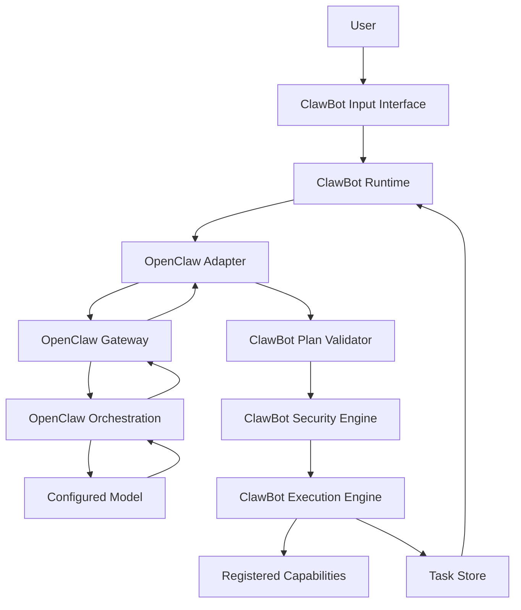
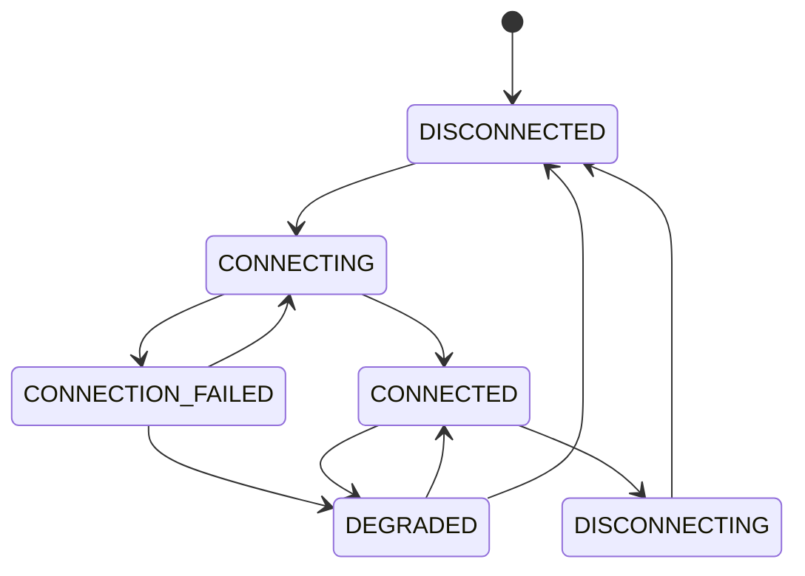
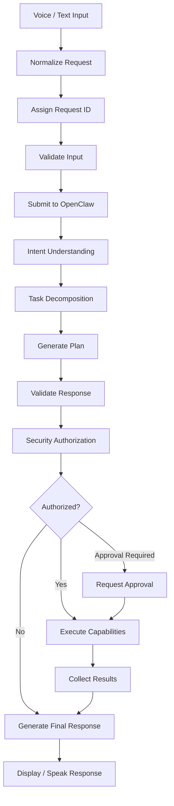
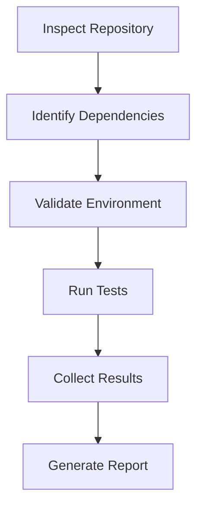
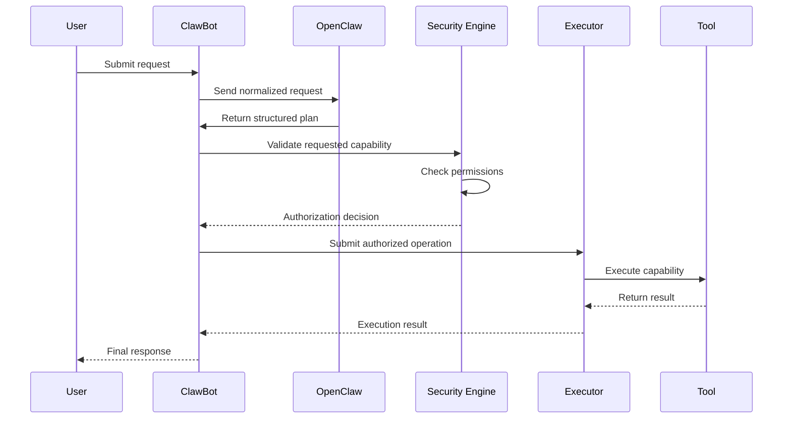
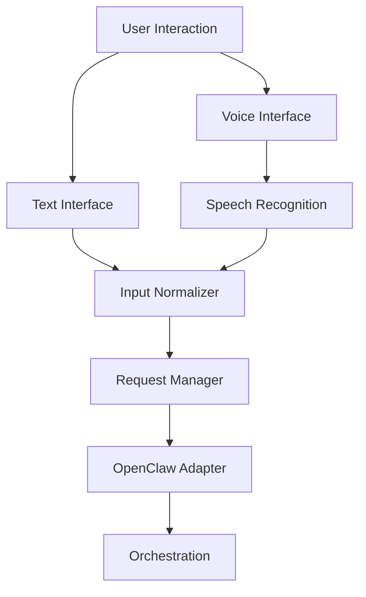

# ClawBot Agent — Orchestration Engineering Specification

**Document ID:** CLAW-DOC-005  
**Version:** 1.0.0  
**Document Type:** Agent Orchestration and Integration Specification  
**Project:** ClawBot Agent  
**Orchestration Backend:** OpenClaw  
**Integration Architecture:** Adapter-Based  
**Execution Strategy:** Structured, Policy-Controlled Execution  
**Input Sources:** Voice and Text  
**Task Coordination:** Event-Driven  
**Status:** Engineering Specification  

---

# 1. Introduction

## 1.1 Purpose

This document defines the orchestration architecture of ClawBot Agent and establishes how the application integrates with OpenClaw.

Orchestration is responsible for coordinating the complete lifecycle of an intelligent agent request, from initial interpretation to planning, tool coordination and final response generation.

The objective is to develop a reliable orchestration integration that can coordinate complex user requests without tightly coupling the ClawBot application to one specific backend.

## 1.2 Orchestration Objectives

The orchestration subsystem must:

1. Receive normalized user requests.
2. Understand user intent through the configured orchestration backend.
3. Decompose complex requests into manageable tasks.
4. Generate structured execution plans.
5. Coordinate registered capabilities.
6. Track task dependencies.
7. Manage execution results.
8. Handle failures and retries.
9. Maintain task context.
10. Return understandable responses.
11. Support both voice and text interaction.
12. Respect application security policies.

## 1.3 Architectural Principle

ClawBot must not duplicate functionality already provided by OpenClaw without a clear technical reason.

Instead, it should integrate through a well-defined adapter.

The application must retain ownership of its security policies, device integrations, runtime lifecycle and application-specific execution boundaries.

---

# 2. OpenClaw Integration Architecture

## 2.1 Integration Overview

OpenClaw is the selected orchestration backend for ClawBot.

The integration must be based on the actual supported interfaces of the installed OpenClaw version.

The architecture should not assume that OpenClaw exposes a particular Python package or unrestricted API.

The adapter will encapsulate communication details.



## 2.2 Responsibility Separation

| Responsibility | Owner |
|---|---|
| Keyboard interaction | ClawBot |
| Microphone management | ClawBot |
| Speech recognition | ClawBot |
| Application lifecycle | ClawBot |
| Request normalization | ClawBot |
| Natural-language orchestration | OpenClaw integration |
| Model coordination | Configured orchestration backend |
| Application permission policies | ClawBot |
| Capability registration | ClawBot |
| Controlled device execution | ClawBot |
| Application task persistence | ClawBot |
| User-facing output | ClawBot |

OpenClaw may provide its own session, memory, tool and execution facilities. Their use must be evaluated against ClawBot's security and ownership requirements before integration.

---

# 3. OpenClaw Gateway Integration

## 3.1 Gateway Architecture

The OpenClaw Gateway is the primary integration boundary to investigate and use when supported by the installed version.

The adapter must encapsulate:

- Gateway endpoint configuration.
- Connection management.
- Authentication.
- Request serialization.
- Response parsing.
- Error handling.
- Connection health monitoring.
- Reconnection behavior.

## 3.2 Connection Lifecycle



## 3.3 Connection Configuration

Illustrative configuration:

```yaml
orchestration:
  provider: openclaw

  openclaw:
    enabled: true
    gateway_url: "${OPENCLAW_GATEWAY_URL}"
    authentication:
      type: token
      token_env: OPENCLAW_TOKEN

    connection:
      timeout_seconds: 15
      health_check_interval: 30
      reconnect_attempts: 3
      reconnect_delay_seconds: 5
```

The actual authentication mechanism and gateway address must be taken from the installed OpenClaw configuration.

Secrets must be supplied through secure configuration mechanisms, not committed to Git.

## 3.4 Connection Validation

Before accepting orchestration requests, the adapter should verify:

1. The gateway address is configured.
2. Authentication credentials are available.
3. The endpoint is reachable.
4. The service responds correctly.
5. The protocol version is supported.
6. Required orchestration capabilities are available.

A successful network connection alone does not establish that orchestration is operational.

---

# 4. Orchestration Adapter

## 4.1 Design Objective

The adapter isolates ClawBot from backend-specific implementation details.

This allows the orchestration backend to evolve without rewriting the application runtime.

## 4.2 Adapter Interface

Illustrative Python interface:

```python
from typing import Protocol


class OrchestratorAdapter(Protocol):

    async def connect(self) -> None:
        ...

    async def submit_request(
        self,
        request: "AgentRequest",
    ) -> "OrchestrationResult":
        ...

    async def health_check(self) -> bool:
        ...

    async def close(self) -> None:
        ...
```

The interface defines application-level responsibilities rather than assuming an undocumented OpenClaw API.

## 4.3 Adapter Responsibilities

| Function | Responsibility |
|---|---|
| connect() | Establish backend connectivity |
| submit_request() | Submit a normalized request |
| health_check() | Verify backend availability |
| close() | Release connection resources |
| normalize_response() | Convert backend responses |
| handle_error() | Map backend failures |
| authenticate() | Apply supported authentication |

## 4.4 Backend Independence

The orchestration interface should permit future implementations.

```text
Orchestrator Interface
        |
        +-- OpenClaw Adapter
        |
        +-- Mock Adapter
        |
        +-- Future Backend Adapter
```

The mock adapter is particularly important for automated tests.

---

# 5. Request Processing Pipeline

## 5.1 End-to-End Workflow

A user command must follow a controlled lifecycle.



## 5.2 Request Envelope

Every request should have a standard internal representation.

```json
{
  "request_id": "req-001",
  "session_id": "session-001",
  "source": "voice",
  "content": "Open my development project",
  "timestamp": "2026-11-17T10:30:00Z",
  "metadata": {
    "language": "en"
  }
}
```

The request identifier should be unique and preserved throughout execution.

## 5.3 Response Envelope

The adapter should normalize backend results.

```json
{
  "request_id": "req-001",
  "status": "success",
  "response": "I have completed the requested operation.",
  "plan": [],
  "metadata": {
    "provider": "openclaw"
  }
}
```

The example represents the internal response contract, not a claim about OpenClaw's native response format.

---

# 6. Intent Understanding and Task Decomposition

## 6.1 Intent Understanding

The orchestration backend should interpret natural-language commands.

Examples:

- Open a development application.
- Find a particular file.
- Analyze a project repository.
- Execute a test suite.
- Generate a development report.
- Explain a build failure.

The intent layer should identify:

- User objective.
- Required context.
- Required capabilities.
- Expected outcome.
- Execution constraints.

## 6.2 Task Decomposition

Complex requests should be converted into smaller, independently identifiable tasks.

Example:

User command:

"Analyze my project, run its tests and prepare a report."

Decomposition:

```text
TASK-001: Analyze Project
    |
    +-- STEP-001: Identify project structure
    |
    +-- STEP-002: Inspect configuration
    |
    +-- STEP-003: Identify test framework
    |
    +-- STEP-004: Analyze dependencies
    |
    +-- STEP-005: Execute permitted tests
    |
    +-- STEP-006: Collect test results
    |
    +-- STEP-007: Generate report
```

Each step should have:

- Unique identifier.
- Description.
- Required capability.
- Input parameters.
- Dependencies.
- Timeout.
- Expected output.
- Execution status.

## 6.3 Dependency Management

The task manager must understand dependencies.

For example:



A dependent step must not begin before its prerequisites have completed successfully.

## 6.4 Parallel Execution

Independent tasks may eventually execute in parallel.

Parallelism must be explicitly defined in the execution plan.

The system must enforce:

- Maximum concurrency.
- Resource limits.
- Dependency validation.
- Cancellation propagation.
- Independent result tracking.

Sequential execution should remain the initial implementation target.

---

# 7. Capability Coordination

## 7.1 Capability Ownership

ClawBot owns the application-level capability registry.

OpenClaw may have its own tools and skills, but these must not automatically be treated as authorized ClawBot operations.

A clear mapping must exist between orchestration requests and registered application capabilities.

## 7.2 Capability Mapping

| Capability identifier | Function |
|---|---|
| application.open | Open approved applications |
| filesystem.read | Read authorized files |
| filesystem.write | Write authorized workspace files |
| filesystem.search | Search permitted directories |
| development.test | Run registered test workflows |
| system.status | Retrieve permitted system information |
| task.cancel | Cancel an active task |

These are proposed capability identifiers.

Each capability must have an implemented handler before it is exposed to orchestration.

## 7.3 Tool Invocation Flow



## 7.4 Tool Result Handling

Tool results should be converted into structured internal responses.

The application must not blindly trust tool output.

Results should be validated for:

- Expected data type.
- Maximum size.
- Expected structure.
- Error conditions.
- Sensitive information.
- Task association.

Tool output must not be allowed to modify security policies.

---

# 8. Session and Context Management

## 8.1 Session Management

A session represents a continuous interaction context.

The session manager should support:

- Session creation.
- Session identification.
- Session expiration.
- Context retrieval.
- Session closure.
- Task association.

## 8.2 Context Management

Context should be divided into logical categories.

| Context type | Purpose |
|---|---|
| Current request | Active user instruction |
| Task context | Information needed for current execution |
| Session context | Recent interaction history |
| Persistent preferences | Explicitly configured user preferences |
| Execution context | Task and capability results |

Not all context should be transmitted to the orchestration backend.

The application should minimize data transfer.

## 8.3 Memory Management

Memory functionality should be modular.

Possible categories:

- Short-term conversational context.
- Task history.
- Explicit user preferences.
- Project-specific information.
- Long-term knowledge.

Persistent memory must support inspection, modification and deletion according to application privacy requirements.

## 8.4 Context Limits

The system should enforce:

- Maximum context size.
- Session expiration.
- Memory retention policies.
- Sensitive-data filtering.
- Context truncation or summarization.

---

# 9. Voice and Text Orchestration

## 9.1 Unified Command Processing

Voice and text requests must converge before orchestration.



## 9.2 Text-Only Operation

Text input must remain available independently of the microphone.

If audio initialization fails, the system should:

1. Record the audio failure.
2. Disable voice input.
3. Preserve the core runtime.
4. Enable terminal interaction.
5. Continue accepting commands.

## 9.3 Voice Feedback

After execution, the response can be delivered through:

- Terminal output.
- Desktop notifications.
- Optional speech synthesis.

Speech synthesis failure must not change the execution result.

## 9.4 Activation and Wake Word

The system should support multiple activation mechanisms.

| Activation | Purpose |
|---|---|
| Enter key | Submit typed command |
| Configured shortcut | Activate interaction |
| Push-to-talk | Start temporary recording |
| Wake word | Activate hands-free interaction |
| Desktop control | Future graphical activation |

Wake-word processing should remain optional and configurable.

---

# 10. Execution Coordination

## 10.1 Execution Engine

The execution engine receives operations only after validation and authorization.

It is responsible for:

- Capability lookup.
- Parameter validation.
- Execution scheduling.
- Timeout enforcement.
- Cancellation.
- Result collection.
- Error reporting.

## 10.2 Execution State

Each step should maintain a state.

```text
PENDING
    |
    v
READY
    |
    v
RUNNING
    |
    +------> COMPLETED
    |
    +------> FAILED
    |
    +------> CANCELLED
```

Additional states may be introduced for waiting on approval or dependencies.

## 10.3 Idempotency

Operations that may be retried should declare whether they are idempotent.

Examples:

| Operation | Retry consideration |
|---|---|
| Read a file | Generally safe |
| Retrieve system status | Generally safe |
| Create a new file | May create duplicates |
| Send an external message | May send duplicates |
| Delete a resource | Potentially destructive |

The task manager must not blindly retry non-idempotent operations.

## 10.4 Cancellation

Cancellation should propagate through:

- Runtime.
- Task manager.
- Orchestration adapter where supported.
- Execution engine.
- Running capability.

The system should report whether cancellation was requested, accepted or completed.

---

# 11. Failure Handling and Resilience

## 11.1 Failure Categories

| Failure | Expected response |
|---|---|
| Gateway unavailable | Report orchestration unavailable |
| Authentication failure | Reject connection |
| Request timeout | Mark request failed or retry safely |
| Invalid response | Reject malformed response |
| Model failure | Report backend failure |
| Unknown capability | Reject execution |
| Authorization failure | Block operation |
| Tool failure | Record failed step |
| Database failure | Report persistence failure |
| Voice subsystem failure | Continue text operation |

## 11.2 Retry Strategy

Retries should be bounded and configurable.

Illustrative configuration:

```yaml
orchestration:
  retry:
    maximum_attempts: 3
    initial_delay_seconds: 2
    maximum_delay_seconds: 15
    exponential_backoff: true
```

Retries should apply only to appropriate transient failures.

Authentication errors and invalid plans should not be repeatedly retried without intervention.

## 11.3 Circuit Breaker

A circuit breaker may be introduced for repeated backend failures.

States:

- CLOSED: Requests permitted.
- OPEN: Requests temporarily blocked.
- HALF_OPEN: Limited health-check attempts.

This prevents repeated failed requests from consuming unnecessary resources.

---

# 12. Observability and Execution Tracing

## 12.1 Task Correlation

Every request, orchestration interaction and execution step should be traceable.

Identifiers:

- Request ID.
- Session ID.
- Task ID.
- Step ID.
- Event ID.
- Capability ID.

## 12.2 Event Types

Suggested event identifiers:

```text
orchestration.connected
orchestration.disconnected
orchestration.request_submitted
orchestration.response_received
orchestration.plan_rejected
orchestration.plan_approved
orchestration.execution_started
orchestration.execution_completed
orchestration.execution_failed
orchestration.retry_scheduled
orchestration.cancelled
```

## 12.3 Metrics

The system should eventually track:

- Request processing duration.
- Gateway response time.
- Planning duration.
- Number of tool invocations.
- Execution success rate.
- Execution failure rate.
- Retry count.
- Approval waiting time.
- Active task count.

Metrics must not expose credentials or sensitive command content.

---

# 13. Configuration Management

## 13.1 Orchestration Configuration

The orchestration configuration should be maintained separately from source code.

Illustrative configuration:

```yaml
orchestration:
  enabled: true
  provider: openclaw

  session:
    enabled: true
    idle_timeout_minutes: 30

  execution:
    maximum_steps: 20
    maximum_parallel_tasks: 2
    timeout_seconds: 120

  safety:
    validate_all_plans: true
    reject_unknown_capabilities: true
    require_authorization: true

  recovery:
    retry_enabled: true
    maximum_attempts: 3
```

The values are initial design proposals, not measured performance limits.

## 13.2 Configuration Validation

At startup, ClawBot should verify:

- Required fields.
- Supported provider.
- Valid endpoint.
- Available credentials.
- Valid timeout values.
- Execution limits.
- Security settings.

Invalid configuration should produce an actionable error.

Security-critical settings must not silently fall back to weaker defaults.

---

# 14. Testing Strategy

## 14.1 Unit Testing

Test individual components independently.

Examples:

- Adapter request serialization.
- Response normalization.
- Task decomposition validation.
- Capability mapping.
- Retry calculations.
- Session expiration.
- Task state transitions.

## 14.2 Integration Testing

Test ClawBot against a real or controlled OpenClaw instance.

Validation should include:

1. Gateway connection.
2. Authentication.
3. Request submission.
4. Response handling.
5. Invalid response handling.
6. Connection interruption.
7. Reconnection.
8. Task coordination.

## 14.3 Mock Testing

The mock adapter should support:

- Successful responses.
- Timeouts.
- Authentication failures.
- Malformed responses.
- Backend disconnections.
- Invalid plans.

This enables reliable testing without requiring a running model for every test.

## 14.4 Acceptance Tests

| Test ID | Test | Expected result |
|---|---|---|
| ORCH-001 | Connect to OpenClaw | Successful connection |
| ORCH-002 | Invalid authentication | Connection rejected |
| ORCH-003 | Submit text request | Request processed |
| ORCH-004 | Submit voice transcript | Request processed |
| ORCH-005 | Malformed response | Response rejected |
| ORCH-006 | Unknown capability | Execution rejected |
| ORCH-007 | Unauthorized action | Execution blocked |
| ORCH-008 | Gateway disconnect | Graceful failure |
| ORCH-009 | Gateway reconnect | Connectivity restored |
| ORCH-010 | Multi-step task | Dependencies respected |
| ORCH-011 | Task cancellation | Cancellation propagated |
| ORCH-012 | Repeated transient failure | Retry limit enforced |
| ORCH-013 | Mock backend | Tests execute without OpenClaw |
| ORCH-014 | Microphone unavailable | Text interface operational |

---

# 15. Implementation Roadmap

## Phase 1 — OpenClaw Discovery

- Inspect the installed OpenClaw version.
- Study its supported gateway interface.
- Identify authentication requirements.
- Verify session behavior.
- Identify tool and capability integration mechanisms.
- Document supported request and response formats.

**Deliverable:** Verified OpenClaw integration specification.

## Phase 2 — Adapter Implementation

- Define the orchestration interface.
- Implement OpenClaw adapter.
- Implement mock adapter.
- Implement configuration.
- Implement connection health checks.
- Add unit tests.

**Deliverable:** Working backend connectivity.

## Phase 3 — Request and Task Management

- Implement normalized requests.
- Implement task models.
- Implement task lifecycle.
- Implement structured plans.
- Implement dependency validation.

**Deliverable:** Request-to-plan workflow.

## Phase 4 — Security Integration

- Implement plan validation.
- Implement capability mapping.
- Integrate authorization.
- Implement approval workflow.
- Add audit events.

**Deliverable:** Controlled orchestration and execution.

## Phase 5 — Voice and Text Integration

- Integrate text interface.
- Integrate microphone detection.
- Implement speech recognition adapter.
- Implement fallback behavior.
- Integrate optional speech synthesis.

**Deliverable:** Unified multimodal interaction.

## Phase 6 — Advanced Orchestration

- Parallel execution.
- Advanced context management.
- Session persistence.
- Cancellation propagation.
- Circuit breaker.
- Execution tracing.

**Deliverable:** Production-oriented orchestration subsystem.

---

# 16. Engineering Acceptance Criteria

The orchestration subsystem should be considered implemented only when:

1. OpenClaw connectivity uses a verified interface.
2. Backend communication is isolated behind an adapter.
3. Mock orchestration is available for testing.
4. Requests have unique identifiers.
5. Responses are validated.
6. Task plans use structured representations.
7. Unknown capabilities are rejected.
8. Authorization remains controlled by ClawBot.
9. Multi-step dependencies are respected.
10. Execution failures are handled predictably.
11. Retries are bounded.
12. Voice and text use the same orchestration pipeline.
13. Text operation remains available without microphone access.
14. Important events can be traced.
15. Integration tests pass.

---

# 17. References

1. ClawBot Agent Repository: https://github.com/Achyut0617/clawbot_agent
2. OpenClaw Official Repository: https://github.com/openclaw/openclaw
3. OpenClaw Documentation: https://docs.openclaw.ai/
4. Python Asyncio: https://docs.python.org/3/library/asyncio.html
5. Pydantic: https://docs.pydantic.dev/
6. SQLite: https://www.sqlite.org/docs.html
7. pytest: https://docs.pytest.org/
8. OpenTelemetry: https://opentelemetry.io/docs/

---

# 18. Document Maintenance

| Attribute | Value |
|---|---|
| Document ID | CLAW-DOC-005 |
| Version | 1.0.0 |
| Owner | ClawBot Agent Orchestration Engineering |
| Review frequency | Every major orchestration integration change |
| Related documents | ARCHITECTURE.md, DEVELOPMENT.md, SECURITY.md, SYSTEM_DESIGN.md |

**End of Document — CLAW-DOC-005**
