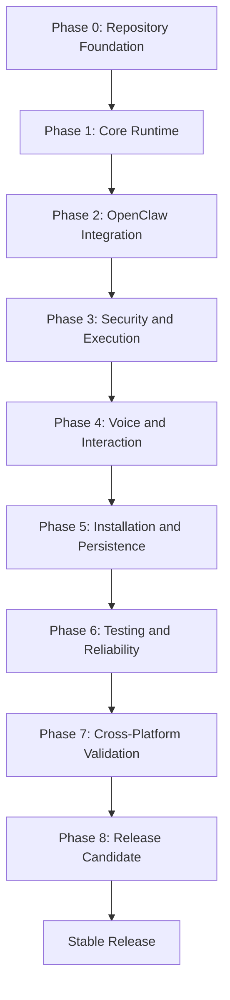
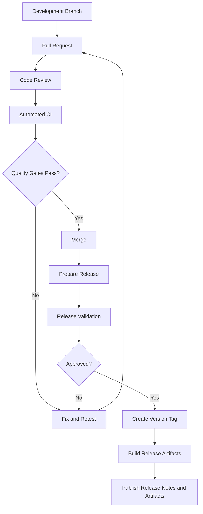

# Roadmap and Release Engineering

**Document ID:** `CB-DOC-008`  
**Project:** ClawBot Agent  
**Version:** 1.0.0  
**Status:** Engineering Planning Specification

---

## 1. Purpose

This document defines the development roadmap, milestone structure, release lifecycle, versioning policy, and delivery criteria for ClawBot.

The roadmap is designed to move the project from its current repository and integration foundations toward a reliable, cross-platform agent with controlled orchestration, voice interaction, optional local inference, and a maintainable release process.

The roadmap is capability-driven. A milestone is complete only when its implementation, tests, documentation, and acceptance criteria are satisfied.

## 2. Product direction

ClawBot is an application-level agent system built around a controlled orchestration architecture.

Its long-term objectives are:

- Natural-language interaction through text and voice.
- OpenClaw-backed orchestration.
- A controlled capability and tool ecosystem.
- Secure execution with explicit authorization.
- Persistent task and event tracking.
- Cross-platform installation.
- Optional local model and hardware acceleration support.
- Extensible integrations.
- Reproducible builds and releases.

### 2.1 Architectural ownership

| Component | Ownership |
|---|---|
| ClawBot runtime | Application lifecycle and request processing |
| Interfaces | Text and voice interaction |
| Orchestration adapter | Integration with OpenClaw |
| Authorization engine | Permissions and approval decisions |
| Capability registry | Available and permitted operations |
| Execution engine | Controlled capability execution |
| Persistence | Task, event, and configuration state |
| Installer | Environment setup and verification |
| CI/CD | Testing, packaging, and release automation |

OpenClaw remains an external orchestration backend. ClawBot must retain ownership of its application security and execution boundaries.

## 3. Development principles

1. Build the core runtime before optional interfaces.
2. Keep orchestration integration behind a documented adapter.
3. Make authorization independent of model-generated plans.
4. Prefer small, independently testable modules.
5. Treat platform-specific support as a verified capability.
6. Keep optional dependencies separate from core dependencies.
7. Require tests and documentation for completed features.
8. Avoid declaring support based only on successful compilation.
9. Use stable interfaces before expanding the capability ecosystem.
10. Release only from validated source states.

## 4. Development phases



## 5. Milestone definitions

### Phase 0 — Repository foundation

**Milestone:** `CB-M00`

Deliverables:

- Repository structure.
- Documentation foundation.
- Development conventions.
- Configuration conventions.
- Dependency management.
- GitHub issue and pull request templates.
- Initial CI workflow.
- Development tracking YAML.

Acceptance criteria:

- Repository structure is documented.
- Development environment can be reproduced.
- CI can install the project.
- Basic static checks execute.
- Contributors can identify and track tasks.

### Phase 1 — Core runtime

**Milestone:** `CB-M01`

Deliverables:

- Application entry point.
- Runtime lifecycle manager.
- Request and response schemas.
- Request normalization.
- Configuration loader.
- Structured logging.
- Error handling.
- Basic CLI.

Acceptance criteria:

- Application starts without optional dependencies.
- Text requests can be accepted.
- Invalid requests are rejected safely.
- Configuration validation works.
- Runtime errors are reported consistently.

### Phase 2 — OpenClaw integration

**Milestone:** `CB-M02`

Deliverables:

- Orchestration adapter interface.
- OpenClaw adapter.
- Connection management.
- Request and response translation.
- Timeout handling.
- Mock orchestration adapter.
- Integration contract tests.

Acceptance criteria:

- Adapter follows the verified supported OpenClaw interface.
- Connection failures are handled.
- Mock integration works without a live backend.
- Malformed responses are rejected.
- Orchestration output cannot directly bypass application validation.

### Phase 3 — Security and controlled execution

**Milestone:** `CB-M03`

Deliverables:

- Capability registry.
- Authorization engine.
- Execution plan validator.
- Approval workflow.
- Controlled execution interface.
- Audit events.
- Secret management integration.

Acceptance criteria:

- Unknown capabilities are denied.
- Sensitive actions require configured approval.
- Invalid plans cannot execute.
- Model output cannot grant permissions.
- Execution decisions are auditable.

### Phase 4 — Voice and interaction

**Milestone:** `CB-M04`

Deliverables:

- Voice input abstraction.
- Speech-to-text adapter.
- Optional text-to-speech adapter.
- Microphone detection.
- Device permission handling.
- Shared text and voice request pipeline.
- Text fallback.

Acceptance criteria:

- Text operation works without audio hardware.
- Voice input can be enabled independently.
- TTS failure does not disable text responses.
- Voice and text use the same authorization pipeline.

### Phase 5 — Installation and persistence

**Milestone:** `CB-M05`

Deliverables:

- Platform detector.
- Hardware detector.
- Environment provisioning.
- Dependency manager.
- Configuration initialization.
- SQLite persistence.
- Database migrations.
- Installation diagnostics.
- Upgrade and uninstall support.

Acceptance criteria:

- A clean supported environment can be provisioned.
- Existing user data is preserved during upgrades.
- Installation verification works.
- Optional components remain optional.

### Phase 6 — Testing and reliability

**Milestone:** `CB-M06`

Deliverables:

- Unit tests.
- Integration tests.
- Adapter contract tests.
- Security tests.
- Failure injection tests.
- End-to-end tests.
- Performance baselines.
- CI quality gates.

Acceptance criteria:

- Required automated tests pass.
- Critical security boundaries are tested.
- Core failure scenarios are covered.
- CI results are reproducible.

### Phase 7 — Cross-platform validation

**Milestone:** `CB-M07`

Deliverables:

- Windows validation.
- Linux validation.
- macOS validation.
- Raspberry Pi validation.
- Jetson validation.
- Resource-aware profiles.
- Platform-specific compatibility documentation.

Acceptance criteria:

- Every declared supported platform has recorded validation evidence.
- Unsupported features are clearly identified.
- Installation and core runtime behavior are verified on declared targets.

### Phase 8 — Release candidate

**Milestone:** `CB-M08`

Deliverables:

- Release candidate build.
- Dependency and security review.
- Installation verification.
- Upgrade and rollback verification.
- Documentation review.
- Release notes.
- Known limitations.
- Final acceptance report.

Acceptance criteria:

- No unresolved release-blocking defects.
- All required quality gates pass.
- Release artifacts are reproducible.
- Compatibility claims are supported by test evidence.

### Stable release

**Milestone:** `CB-M09`

Deliverables:

- Versioned release tag.
- Published source release.
- Installation instructions.
- Release notes.
- Checksums for published artifacts where applicable.
- Known limitations.
- Support and issue-reporting instructions.

## 6. Task decomposition

Milestones must be broken into atomic engineering tasks.

Example:

```yaml
roadmap:
  milestone: CB-M02
  title: OpenClaw Integration
  status: planned

  tasks:
    - id: ORC-001
      title: Define orchestration adapter contract
      status: completed
      priority: critical

    - id: ORC-002
      title: Implement mock orchestration adapter
      status: planned
      priority: high

    - id: ORC-003
      title: Implement OpenClaw connectivity
      status: planned
      priority: high

    - id: ORC-004
      title: Add timeout and connection failure handling
      status: planned
      priority: high

    - id: ORC-005
      title: Add adapter contract tests
      status: planned
      priority: high
```

The example demonstrates the required structure. Actual status values must be synchronized with the repository's current implementation and test evidence.

## 7. Priority classification

| Priority | Meaning |
|---|---|
| P0 | Critical; blocks core runtime or security |
| P1 | Required for the next planned milestone |
| P2 | Important capability or quality improvement |
| P3 | Enhancement or future extension |

Security vulnerabilities and data-loss defects must be evaluated independently of ordinary feature priorities.

## 8. Release channels

ClawBot may use the following release channels.

| Channel | Purpose | Stability |
|---|---|---|
| Development | Active engineering work | Unstable |
| Alpha | Early integrated functionality | Experimental |
| Beta | Feature-complete validation | Pre-release |
| Release candidate | Final validation | Near stable |
| Stable | General release | Supported |

A release channel must be clearly identified in package metadata and release notes.

## 9. Versioning policy

Use Semantic Versioning:

`MAJOR.MINOR.PATCH`

- **MAJOR:** Incompatible public interface or configuration changes.
- **MINOR:** Backward-compatible functionality.
- **PATCH:** Backward-compatible fixes.

Examples:

| Version | Meaning |
|---|---|
| `0.1.0` | Initial experimental release |
| `0.2.0` | New backward-compatible functionality |
| `0.2.1` | Bug-fix release |
| `1.0.0` | First stable public interface |

Before `1.0.0`, interfaces may change more frequently, but changes must still be documented.

## 10. Release workflow



## 11. CI/CD requirements

### Continuous integration

Run on pull requests and relevant pushes:

- Formatting.
- Linting.
- Static typing.
- Unit tests.
- Integration tests.
- Security tests.
- Dependency checks.
- Build verification.

### Continuous delivery

For approved release tags:

- Verify tag and version consistency.
- Run release test suite.
- Build distributable artifacts.
- Generate checksums.
- Produce release notes.
- Publish artifacts after configured approval.

### Continuous deployment

Deployment to a remote service or device is a separate capability. It must not be claimed as implemented merely because packaging and publishing are automated.

## 12. Branching and contribution policy

Recommended branches:

- `main`: protected, releasable code.
- `develop`: optional integration branch if the team adopts it.
- `feature/*`: feature implementation.
- `fix/*`: defect correction.
- `docs/*`: documentation work.
- `release/*`: release preparation.

Use pull requests for changes entering protected branches.

Every pull request should include:

- Problem statement.
- Proposed solution.
- Changed components.
- Tests executed.
- Security implications.
- Documentation updates.
- Related task IDs.

## 13. Release acceptance gates

A release must not proceed unless:

- [ ] Required tests pass.
- [ ] Critical security checks pass.
- [ ] Supported-platform claims are verified.
- [ ] Configuration migration is validated.
- [ ] Installation and upgrade paths work.
- [ ] No known critical data-loss defect remains.
- [ ] Dependencies are reviewed.
- [ ] Release notes are complete.
- [ ] Version metadata is consistent.
- [ ] Artifacts can be traced to a source commit.

## 14. Risk management

| Risk | Impact | Mitigation |
|---|---|---|
| OpenClaw interface changes | Integration failure | Adapter and compatibility tests |
| Optional dependency conflicts | Installation failure | Separate dependency groups |
| Voice hardware unavailable | Voice failure | Text fallback |
| Platform differences | Inconsistent behavior | Platform-specific validation |
| Model output is unsafe | Unauthorized action | Independent authorization |
| Database migration failure | Data loss | Backup and migration tests |
| Scope expansion | Delayed releases | Milestone-based prioritization |
| Unverified compatibility | Misleading release claims | Evidence-based support matrix |

## 15. Progress reporting

Each milestone should report:

- Planned tasks.
- Completed tasks.
- Blocked tasks.
- Open defects.
- Test status.
- Documentation status.
- Security status.
- Remaining acceptance criteria.

Progress must be based on verified implementation evidence, not only the number of commits or files created.

## 16. Definition of Done

A milestone is complete when all required tasks have been implemented, reviewed, tested, documented, and accepted.

A release is complete when its artifacts, source tag, compatibility claims, release notes, and validation evidence are available.

**Engineering principle:** Release readiness is demonstrated by verified behavior and reproducible evidence, not by feature count.
