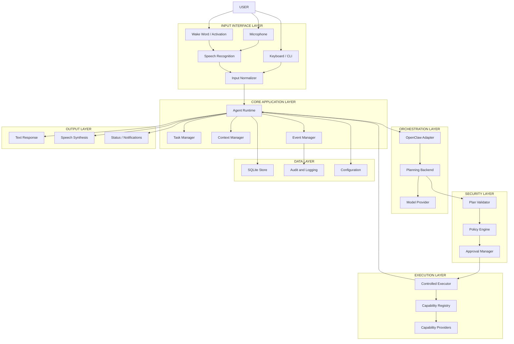
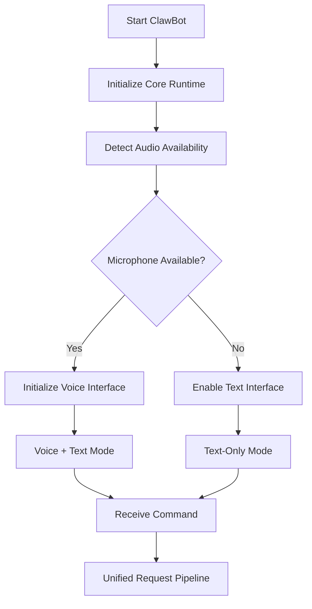
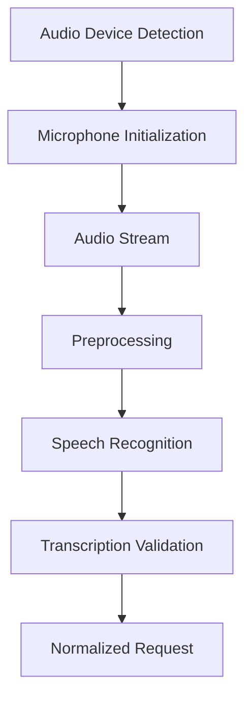
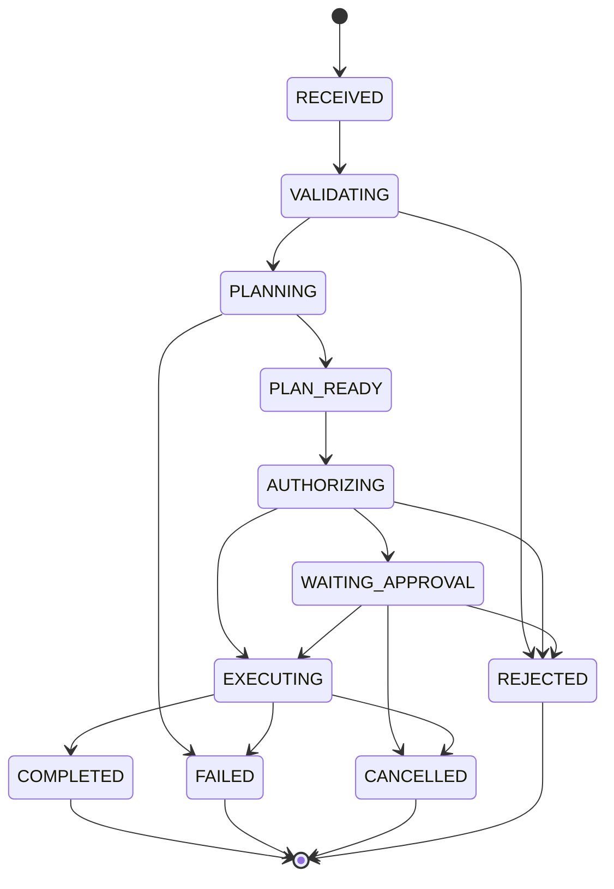

# ClawBot Agent — System Design Specification

**Document ID:** CLAW-DOC-004  
**Version:** 1.0.0  
**Document Type:** System Design and Technical Specification  
**Project:** ClawBot Agent  
**Primary Language:** Python  
**Application Architecture:** Modular, Layered and Event-Driven  
**Orchestration Backend:** OpenClaw  
**Input Interfaces:** Voice and Text  
**Execution Model:** Controlled Capability-Based Execution  
**Persistence:** SQLite  
**Configuration:** YAML and Environment Variables  
**Deployment:** Cross-Platform  
**Status:** Engineering Specification  

---

# 1. Introduction

## 1.1 Purpose

This document defines the technical design of ClawBot Agent.

It establishes the internal structure, component responsibilities, communication interfaces, data models, execution pipeline and deployment requirements necessary to implement the system.

The document acts as a bridge between the architectural concepts and their actual software implementation.

It defines:

- System requirements.
- Functional and non-functional requirements.
- Component decomposition.
- Voice and text input architecture.
- OpenClaw integration.
- Task planning and execution.
- Capability registration.
- Model provider integration.
- Persistence and event management.
- Installation and device compatibility.
- Error handling and recovery.
- System validation criteria.

## 1.2 System Objective

ClawBot is intended to be a local-first, voice-enabled intelligent agent that allows users to interact with their devices through natural language.

The system must support both voice and text commands.

Its primary responsibility is to coordinate user requests through an orchestration backend and execute authorized operations using registered capabilities.

The system should remain functional when optional hardware or external services are unavailable.

## 1.3 Design Principles

The system follows these principles:

1. Modularity: Each subsystem has a defined responsibility.
2. Portability: Device-specific functionality is isolated.
3. Interoperability: Components communicate through defined interfaces.
4. Extensibility: New capabilities can be registered without redesigning the runtime.
5. Reliability: Failures in optional components should not unnecessarily terminate the application.
6. Security: Every sensitive operation passes through authorization.
7. Observability: Task execution can be inspected and traced.
8. Recoverability: Interrupted tasks should have predictable recovery behavior.
9. Local-first operation: Core interaction should not inherently depend on cloud connectivity.
10. Backend independence: The application should avoid coupling its entire runtime to one orchestration implementation.

---

# 2. System Requirements

## 2.1 Functional Requirements

| ID | Requirement | Priority |
|---|---|---|
| FR-001 | Start and stop the agent runtime | Critical |
| FR-002 | Accept keyboard-based commands | Critical |
| FR-003 | Accept voice-based commands | High |
| FR-004 | Detect microphone availability | High |
| FR-005 | Fall back to text when audio is unavailable | Critical |
| FR-006 | Normalize different input sources | Critical |
| FR-007 | Forward requests to OpenClaw | Critical |
| FR-008 | Process structured execution plans | Critical |
| FR-009 | Validate plans before execution | Critical |
| FR-010 | Enforce authorization policies | Critical |
| FR-011 | Support registered capabilities | Critical |
| FR-012 | Maintain task execution state | Critical |
| FR-013 | Persist task history | High |
| FR-014 | Provide user-facing responses | High |
| FR-015 | Support speech feedback | Medium |
| FR-016 | Manage configuration | High |
| FR-017 | Detect platform and dependencies | High |
| FR-018 | Provide installation and setup management | High |
| FR-019 | Support task cancellation | High |
| FR-020 | Provide diagnostic information | High |

## 2.2 Non-Functional Requirements

| ID | Requirement | Design objective |
|---|---|---|
| NFR-001 | Portability | Support multiple operating systems |
| NFR-002 | Reliability | Recover from optional subsystem failures |
| NFR-003 | Maintainability | Independent modules |
| NFR-004 | Security | Default-deny authorization |
| NFR-005 | Performance | Avoid unnecessary processing overhead |
| NFR-006 | Extensibility | Provider and capability adapters |
| NFR-007 | Observability | Structured logs and task identifiers |
| NFR-008 | Resource efficiency | Configurable model and audio workloads |
| NFR-009 | Testability | Dependency injection and isolated tests |
| NFR-010 | Reproducibility | Versioned dependencies and configuration |

---

# 3. High-Level System Decomposition

## 3.1 Component Architecture

ClawBot is divided into the following logical subsystems.



## 3.2 Subsystem Responsibilities

| Subsystem | Responsibility |
|---|---|
| Input | Receive user commands |
| Audio | Manage microphone and audio processing |
| Runtime | Coordinate application lifecycle |
| Task Manager | Manage task state and execution |
| Context Manager | Manage relevant task context |
| Orchestration | Communicate with OpenClaw |
| Model Provider | Support model backends |
| Security | Validate and authorize actions |
| Capability Registry | Maintain available operations |
| Executor | Execute approved capabilities |
| Storage | Persist tasks and events |
| Configuration | Load and validate settings |
| Output | Deliver responses to users |
| Installer | Provision application dependencies |

---

# 4. Unified Input Architecture

## 4.1 Design Objective

ClawBot must support multiple interaction methods without implementing separate execution pipelines.

The same command should be processable whether it originates from:

- A keyboard.
- A terminal.
- A microphone.
- A speech recognition engine.
- A future desktop interface.
- A future remote client.

The input interface should only determine how the request enters the system.

It should not determine how the request is authorized or executed.

## 4.2 Input Sources

### Text Input

Text input should be available through the CLI independently of audio initialization.

Example:

```text
clawbot> Open VS Code and show my project directory.
```

Expected sequence:

1. Read text input.
2. Validate input.
3. Normalize request.
4. Submit to runtime.
5. Generate execution plan.
6. Validate plan.
7. Execute authorized operations.
8. Return the response.

### Voice Input

Voice input follows a separate acquisition pipeline but converges into the same normalized request interface.

```text
Microphone
    |
    v
Audio Capture
    |
    v
Speech Recognition
    |
    v
Transcribed Text
    |
    v
Input Normalizer
    |
    v
Agent Runtime
```

## 4.3 Unified Request Model

Both input types should produce a common request object.

Illustrative model:

```python
from dataclasses import dataclass
from datetime import datetime
from typing import Literal
from uuid import uuid4


@dataclass
class AgentRequest:
    request_id: str
    source: Literal["text", "voice"]
    content: str
    created_at: datetime

    @classmethod
    def create(
        cls,
        content: str,
        source: Literal["text", "voice"],
    ):
        return cls(
            request_id=str(uuid4()),
            source=source,
            content=content,
            created_at=datetime.now().astimezone(),
        )
```

The production implementation should additionally validate empty input, maximum length and supported source values.

## 4.4 Microphone Availability Detection

Audio must be treated as an optional subsystem.

At startup:

1. Detect whether an audio backend is installed.
2. Detect available input devices.
3. Validate microphone accessibility.
4. Attempt initialization.
5. Record audio subsystem status.
6. Continue runtime initialization regardless of optional microphone failure.

Expected states:

| State | Behavior |
|---|---|
| AVAILABLE | Voice commands enabled |
| NOT_FOUND | Text interface remains active |
| PERMISSION_DENIED | Report microphone permission issue |
| INITIALIZATION_FAILED | Disable voice subsystem |
| DEVICE_BUSY | Offer retry or text input |
| BACKEND_MISSING | Provide optional installation guidance |

## 4.5 Input Fallback

The fallback behavior is a mandatory system requirement.



The application must never terminate solely because microphone hardware is unavailable.

## 4.6 Activation Mechanisms

The input system should support multiple activation methods.

| Mechanism | Description |
|---|---|
| Keyboard Enter | Submit a typed command |
| CLI prompt | Interactive terminal input |
| Keyboard shortcut | Global or application-level activation |
| Wake word | Activate voice recognition |
| Push-to-talk | Hold or press a configured key |
| Desktop button | Future graphical activation |

Activation mechanisms should be configurable.

Global keyboard shortcuts and wake-word detection are optional extensions, not prerequisites for the initial runtime.

---

# 5. Audio Processing Architecture

## 5.1 Audio Pipeline

The audio subsystem should be independently initialized and managed.



## 5.2 Audio Components

| Component | Responsibility |
|---|---|
| Device Manager | Discover available devices |
| Audio Capture | Acquire microphone samples |
| Audio Preprocessor | Prepare audio for recognition |
| Speech Recognizer | Convert speech to text |
| Confidence Validator | Evaluate recognition confidence |
| Activation Manager | Handle wake-word and push-to-talk events |

## 5.3 Candidate Technologies

| Technology | Purpose |
|---|---|
| Vosk | Offline speech recognition |
| faster-whisper | Speech recognition using Whisper models |
| sounddevice | Audio input and output |
| PortAudio | Cross-platform audio I/O backend |
| openWakeWord | Wake-word detection |
| Piper | Local text-to-speech |

Technology selection should consider device resources, supported languages, licensing and deployment requirements.

The audio architecture must not depend on one particular recognition engine.

---

# 6. OpenClaw Orchestration Architecture

## 6.1 Orchestration Responsibility

OpenClaw is intended to serve as the external orchestration backend.

Its responsibilities may include:

- Interpreting natural-language requests.
- Planning multi-step operations.
- Coordinating available agent tools.
- Managing model interactions.
- Returning task execution results.

ClawBot remains responsible for its own application lifecycle, input interfaces, authorization policies, persistence and device-specific execution boundaries.

## 6.2 Integration Boundary

The OpenClaw integration should be implemented through an adapter.

```text
Agent Runtime
     |
     v
Orchestration Interface
     |
     v
OpenClaw Adapter
     |
     v
OpenClaw Gateway / Supported Interface
     |
     v
Orchestration Backend
```

The application should not assume that OpenClaw provides an arbitrary Python API.

The adapter must use a verified and documented OpenClaw interface, including its actual authentication and request/response protocol.

## 6.3 Orchestration Interface

Illustrative interface:

```python
from typing import Protocol


class Orchestrator(Protocol):

    async def connect(self) -> None:
        ...

    async def plan(
        self,
        request: "AgentRequest",
    ) -> "ExecutionPlan":
        ...

    async def health_check(self) -> bool:
        ...

    async def close(self) -> None:
        ...
```

A fake implementation should be available for unit testing.

## 6.4 OpenClaw Adapter Responsibilities

The adapter should:

1. Establish a connection.
2. Authenticate using configured credentials.
3. Submit normalized requests.
4. Handle timeouts.
5. Validate response structure.
6. Convert backend responses into internal models.
7. Report connection failures.
8. Support graceful disconnection.

## 6.5 Backend Failure Handling

If OpenClaw becomes unavailable:

- Preserve the application runtime.
- Keep text interaction available.
- Inform the user.
- Avoid executing incomplete plans.
- Preserve pending task information where possible.
- Allow controlled reconnection.

The application must not bypass security checks simply because the orchestration backend fails.

---

# 7. Task Planning and Execution Architecture

## 7.1 Task Lifecycle

Every accepted request should have an explicit lifecycle.



## 7.2 Task States

| State | Description |
|---|---|
| RECEIVED | Request received |
| VALIDATING | Input validation |
| PLANNING | Orchestration in progress |
| PLAN_READY | Execution plan available |
| AUTHORIZING | Security evaluation |
| WAITING_APPROVAL | Awaiting user decision |
| EXECUTING | Authorized execution |
| COMPLETED | Successfully completed |
| FAILED | Execution failed |
| REJECTED | Security or validation rejection |
| CANCELLED | Cancelled by user or system |

State transitions must be validated by the task manager.

## 7.3 Execution Plan

An execution plan should consist of structured steps.

Illustrative structure:

```json
{
  "task_id": "task-001",
  "description": "Open a development environment",
  "steps": [
    {
      "step_id": "step-001",
      "capability": "application.open",
      "parameters": {
        "application": "code"
      },
      "depends_on": [],
      "risk_level": "R1"
    }
  ]
}
```

The application should independently determine the authoritative risk classification from the capability registry rather than trusting the model-provided value.

## 7.4 Execution Rules

Each step must:

- Reference a registered capability.
- Satisfy its input schema.
- Pass security validation.
- Satisfy dependency requirements.
- Respect execution limits.
- Produce a structured result.

An execution plan must not be treated as a single unrestricted shell script.

## 7.5 Sequential and Parallel Execution

The task manager should initially support sequential execution.

Parallel execution can be introduced later for independent, explicitly safe operations.

Example:

```text
Task
 |
 +-- Step 1: Read project metadata
 |
 +-- Step 2: Read configuration
 |
 +-- Step 3: Analyze dependencies
 |
 +-- Step 4: Generate report
```

Steps with dependencies must not execute before their prerequisites complete.

Parallel execution should enforce concurrency and resource limits.

---

# 8. Capability and Tool Architecture

## 8.1 Capability Registry

Capabilities represent operations the agent is allowed to perform.

The capability registry maintains the available operations and their metadata.

Examples:

- Open an application.
- Read an authorized file.
- Create a file in the workspace.
- Search permitted directories.
- Execute a predefined development command.
- Retrieve system information.
- Manage a task.

## 8.2 Capability Definition

Illustrative interface:

```python
from dataclasses import dataclass
from typing import Any, Callable


@dataclass
class Capability:
    name: str
    description: str
    risk_level: str
    requires_approval: bool
    handler: Callable[..., Any]
```

The production model should use validated parameter schemas and explicit permission requirements.

## 8.3 Capability Registration

Capabilities should be registered through a controlled mechanism.

```text
Capability Registry
       |
       +-- application.open
       |
       +-- filesystem.read
       |
       +-- filesystem.write
       |
       +-- system.status
       |
       +-- development.test
       |
       +-- task.cancel
```

Unknown capabilities must be rejected.

## 8.4 Plugin Extension Model

The system should eventually support external capability providers.

Each provider must declare:

- Provider identifier.
- Version.
- Supported capabilities.
- Required permissions.
- Configuration.
- Dependencies.
- Compatibility requirements.

Third-party extensions must not automatically receive unrestricted access.

---

# 9. Model Provider Architecture

## 9.1 Provider Independence

ClawBot should separate model communication from the core runtime.

Possible providers include:

| Provider | Deployment |
|---|---|
| Ollama | Local |
| OpenAI-compatible API | Remote or local |
| Other supported inference servers | Configurable |
| OpenClaw-managed model backend | Orchestration managed |

These are integration possibilities, not a claim that every provider is already implemented.

## 9.2 Model Adapter

The application should use provider abstractions where direct model access is required.

Illustrative interface:

```python
from typing import Protocol


class ModelProvider(Protocol):

    async def generate(
        self,
        prompt: str,
    ) -> str:
        ...

    async def health_check(self) -> bool:
        ...
```

Model-provider communication should remain separate from execution authorization.

## 9.3 Model Selection

Model selection should consider:

- Available memory.
- CPU and GPU resources.
- Model size.
- Quantization.
- Latency.
- Language support.
- Context requirements.

A smaller local model may be preferred for resource-constrained devices.

---

# 10. Data Architecture

## 10.1 Persistence Strategy

SQLite is the initial persistence layer.

It provides:

- Local storage.
- No separate database server requirement.
- Transaction support.
- Simple backup.
- Suitable storage for task history and configuration metadata.

The storage interface should allow future migration to another database.

## 10.2 Core Data Entities

| Entity | Purpose |
|---|---|
| AgentTask | Main task record |
| TaskStep | Individual execution steps |
| TaskEvent | Lifecycle events |
| Capability | Registered capability metadata |
| Approval | User authorization decisions |
| AgentSession | Interaction session |
| SystemEvent | Operational events |

## 10.3 Task Record

Illustrative record:

```json
{
  "task_id": "task-001",
  "source": "text",
  "status": "COMPLETED",
  "created_at": "2026-11-17T10:30:00Z",
  "completed_at": "2026-11-17T10:30:05Z"
}
```

## 10.4 Storage Requirements

The persistence layer should support:

- Task creation.
- Task updates.
- State transition history.
- Event recording.
- Approval history.
- Task retrieval.
- Task cancellation records.
- Database migrations.

Sensitive data must be redacted or excluded according to the security policy.

## 10.5 Transaction Management

Operations involving multiple related records should use database transactions.

For example, task completion and its corresponding completion event should not produce inconsistent database state.

---

# 11. Installation and Device Management

## 11.1 Installation Subsystem

Installation must be separated from application runtime.

The installation manager should be responsible for:

- Environment detection.
- Python version validation.
- Virtual environment creation.
- Dependency installation.
- Optional component installation.
- Configuration initialization.
- Model runtime detection.
- OpenClaw connectivity checks.
- Installation verification.
- Uninstallation.

## 11.2 Device Detection

The platform manager should detect:

- Operating system.
- Operating system version.
- CPU architecture.
- Python version.
- Available memory.
- GPU availability.
- Audio devices.
- Available disk space.

Device detection should provide information for configuration and compatibility decisions.

## 11.3 Platform Abstraction

Platform-specific behavior should be isolated behind interfaces.

```text
Platform Manager
      |
      +-- Windows Adapter
      |
      +-- Linux Adapter
      |
      +-- macOS Adapter
      |
      +-- Edge Device Adapter
```

The core runtime must not contain scattered operating-system-specific logic.

## 11.4 Optional Dependencies

Voice recognition, speech synthesis, GPU acceleration and external orchestration services should be independently configurable.

Failure to install an optional feature must not prevent basic text interaction.

---

# 12. Output and Response Architecture

## 12.1 Output Channels

ClawBot should support:

- Terminal responses.
- Structured task status.
- Speech synthesis.
- Error notifications.
- Future desktop notifications.

## 12.2 Response Model

Illustrative response:

```json
{
  "task_id": "task-001",
  "status": "COMPLETED",
  "message": "Application opened successfully.",
  "output": {
    "application": "code"
  }
}
```

## 12.3 Speech Feedback

Speech synthesis should be optional.

If the speech engine is unavailable:

- Display the response as text.
- Record the output subsystem status.
- Do not fail the completed task.

Speech synthesis must not be coupled to task execution success.

---

# 13. Event-Driven Communication

## 13.1 Event Architecture

Components should communicate through defined interfaces and events.

Events can represent:

- Request received.
- Task created.
- Plan generated.
- Approval requested.
- Execution started.
- Execution completed.
- Execution failed.
- Audio device unavailable.
- Orchestration disconnected.
- Runtime stopped.

## 13.2 Event Structure

Illustrative event:

```json
{
  "event_id": "evt-001",
  "event_type": "task.started",
  "task_id": "task-001",
  "component": "runtime",
  "timestamp": "2026-11-17T10:30:00Z",
  "payload": {}
}
```

## 13.3 Event Handling

Events should be:

- Structured.
- Identifiable.
- Timestamped.
- Associated with a task where applicable.
- Processed without blocking unrelated operations unnecessarily.

Critical task-state updates must not depend solely on an in-memory event queue.

Persistent state transitions should be written to storage.

---

# 14. Error Handling and Recovery

## 14.1 Error Categories

| Category | Example | Expected behavior |
|---|---|---|
| INPUT_ERROR | Empty command | Request rejection |
| AUDIO_ERROR | Microphone unavailable | Text fallback |
| ORCHESTRATION_ERROR | OpenClaw unavailable | Report and preserve runtime |
| MODEL_ERROR | Model timeout | Controlled failure |
| SECURITY_ERROR | Unauthorized operation | Reject and audit |
| EXECUTION_ERROR | Tool failure | Mark step failed |
| STORAGE_ERROR | Database unavailable | Report persistence failure |
| INSTALLATION_ERROR | Missing dependency | Diagnostic guidance |
| PLATFORM_ERROR | Unsupported OS operation | Controlled rejection |

## 14.2 Recovery Strategy

The runtime should support:

- Controlled retries.
- Timeouts.
- Graceful shutdown.
- Task cancellation.
- Connection recovery.
- Persistent state restoration.
- Safe handling of partially completed tasks.

Retries must be bounded and must account for non-idempotent operations.

---

# 15. API and Interface Contracts

## 15.1 Internal Interface Principles

Internal interfaces should define:

- Input types.
- Output types.
- Exceptions.
- Ownership.
- Side effects.
- Security requirements.

Interfaces should not expose unnecessary implementation details.

## 15.2 Interface Mapping

| Interface | Provider | Consumer |
|---|---|---|
| InputAdapter | CLI / Audio | Runtime |
| Orchestrator | OpenClaw Adapter | Runtime |
| ModelProvider | Model backend | Orchestration subsystem |
| PolicyEngine | Security subsystem | Executor |
| CapabilityRegistry | Capability subsystem | Executor |
| TaskStore | SQLite | Runtime / Task Manager |
| OutputAdapter | CLI / TTS | Runtime |
| PlatformAdapter | OS-specific implementation | Installer / Runtime |

## 15.3 Interface Versioning

Interfaces should be versioned when breaking changes are introduced.

Changes to public request models and capability contracts should be documented and covered by compatibility tests.

---

# 16. Observability and Diagnostics

## 16.1 Observability Requirements

ClawBot should expose sufficient information to diagnose:

- Runtime status.
- Audio subsystem status.
- Orchestration connectivity.
- Model provider availability.
- Task execution state.
- Storage health.
- Registered capabilities.
- Installation status.

## 16.2 Correlation

Every request should have a unique identifier.

All related operations should include the request or task identifier in logs and events.

## 16.3 Diagnostic Commands

Future CLI commands should include:

```text
clawbot status
clawbot doctor
clawbot config validate
clawbot audio devices
clawbot orchestrator health
clawbot tasks list
```

These commands should be implemented only when their underlying functionality is available.

---

# 17. Deployment Architecture

## 17.1 Deployment Targets

| Target | Intended deployment |
|---|---|
| Windows laptop | Primary interactive development |
| Ubuntu desktop | Linux runtime |
| macOS | Desktop runtime |
| Raspberry Pi | Lightweight edge agent |
| NVIDIA Jetson | Edge AI deployment |

## 17.2 Deployment Profiles

ClawBot should eventually support configurable deployment profiles.

### Minimal Profile

- Core runtime.
- Text interface.
- SQLite.
- Basic diagnostics.

### Voice Profile

- Minimal profile.
- Microphone support.
- Speech recognition.
- Optional speech synthesis.

### Local AI Profile

- Local model provider.
- OpenClaw integration.
- Resource-aware model configuration.

### Edge Profile

- Reduced dependencies.
- Lightweight input/output.
- Resource monitoring.
- Edge-specific adapters.

### Development Profile

- Testing tools.
- Debug logging.
- Static analysis.
- Mock orchestration.
- Integration testing.

Profiles must describe supported configurations, not imply that every target device supports every feature.

---

# 18. Proposed Implementation Mapping

The following is the target module mapping. Existing files should be extended or reorganized incrementally rather than blindly overwritten.

| Target module | Responsibility |
|---|---|
| `src/clawbot/runtime.py` | Runtime lifecycle |
| `src/clawbot/cli.py` | CLI and command interface |
| `src/clawbot/audio.py` | Audio acquisition |
| `src/clawbot/config.py` | Configuration management |
| `src/clawbot/models.py` | Shared data structures |
| `src/clawbot/orchestrator.py` | Orchestration adapter |
| `src/clawbot/safety.py` | Security enforcement |
| `src/clawbot/store.py` | Persistence |
| `src/clawbot/input/` | Input adapters |
| `src/clawbot/output/` | Output adapters |
| `src/clawbot/capabilities/` | Registered capabilities |
| `src/clawbot/platform/` | Platform abstraction |
| `src/clawbot/installer/` | Installation management |
| `src/clawbot/events/` | Event processing |

A module should only be introduced when its interface and responsibility are understood.

The existing package must remain functional throughout incremental migration.

---

# 19. System Validation Strategy

## 19.1 Core Validation

| Test ID | Validation | Expected result |
|---|---|---|
| SYS-001 | Start runtime | Runtime starts |
| SYS-002 | Text command | Request accepted |
| SYS-003 | Voice command | Request normalized |
| SYS-004 | No microphone | Text mode remains available |
| SYS-005 | Missing audio library | Runtime remains available |
| SYS-006 | OpenClaw unavailable | Graceful failure |
| SYS-007 | Invalid execution plan | Plan rejected |
| SYS-008 | Unauthorized capability | Execution blocked |
| SYS-009 | Task cancellation | Task enters cancelled state |
| SYS-010 | Database persistence | Task records retrievable |
| SYS-011 | Speech output failure | Text response remains available |
| SYS-012 | Unsupported platform operation | Controlled error |
| SYS-013 | Runtime shutdown | Resources released |
| SYS-014 | Restart | Recoverable records preserved |

## 19.2 Integration Validation

The complete system should eventually be validated using these scenarios:

**Scenario A — Text-only operation**

The user submits a command through the terminal without any microphone installed.

Expected result: The command follows the standard orchestration and execution pipeline.

**Scenario B — Voice operation**

The user activates voice interaction and speaks a command.

Expected result: Audio is transcribed and passed into the same request pipeline.

**Scenario C — Microphone unavailable**

The audio subsystem cannot initialize.

Expected result: ClawBot continues in text-only mode.

**Scenario D — OpenClaw unavailable**

The orchestration backend is disconnected.

Expected result: ClawBot remains responsive and reports that orchestration is unavailable.

**Scenario E — Unauthorized operation**

The orchestration backend proposes a restricted operation.

Expected result: The security subsystem rejects the operation.

**Scenario F — Interrupted execution**

A running task is cancelled.

Expected result: The task manager records cancellation and the executor stops safely where possible.

---

# 20. Engineering Acceptance Criteria

The system design is considered implemented only when:

1. Core runtime responsibilities are separated.
2. Voice and text input share a common request model.
3. Microphone failure does not prevent text operation.
4. OpenClaw integration uses a verified interface.
5. Orchestration responses are validated.
6. Execution plans are structured.
7. Authorization is independently enforced.
8. Capabilities are registered and validated.
9. Task states are controlled.
10. Important task events are persisted.
11. Platform-specific behavior is isolated.
12. Installation and runtime responsibilities are separated.
13. Optional dependencies can fail without disabling core text interaction.
14. Automated tests cover the principal execution paths.
15. Documentation reflects verified implementation behavior.

---

# 21. References

1. ClawBot Agent Repository: https://github.com/Achyut0617/clawbot_agent
2. OpenClaw: https://github.com/openclaw/openclaw
3. Python Documentation: https://docs.python.org/3/
4. Python Packaging: https://packaging.python.org/
5. Pydantic: https://docs.pydantic.dev/
6. SQLite: https://www.sqlite.org/docs.html
7. Vosk: https://alphacephei.com/vosk/
8. faster-whisper: https://github.com/SYSTRAN/faster-whisper
9. sounddevice: https://python-sounddevice.readthedocs.io/
10. openWakeWord: https://github.com/dscripka/openWakeWord
11. Piper: https://github.com/OHF-Voice/piper1-gpl
12. pytest: https://docs.pytest.org/
13. Docker: https://docs.docker.com/

---

# 22. Document Maintenance

| Attribute | Value |
|---|---|
| Document ID | CLAW-DOC-004 |
| Version | 1.0.0 |
| Owner | ClawBot Agent System Engineering |
| Review frequency | Major system design changes |
| Related documents | ARCHITECTURE.md, DEVELOPMENT.md, SECURITY.md, ORCHESTRATION.md |

**End of Document — CLAW-DOC-004**
