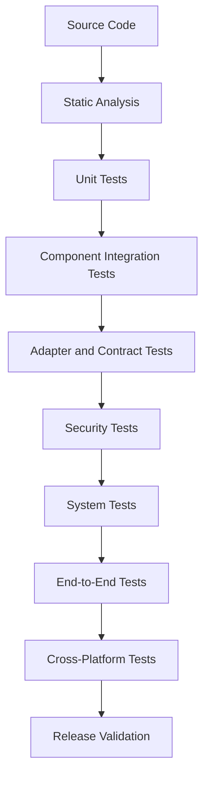

# Testing and Validation Strategy

**Document ID:** `CB-DOC-007`  
**Project:** ClawBot Agent  
**Version:** 1.0.0  
**Status:** Engineering Specification

---

## 1. Purpose

This document defines the testing and validation strategy for ClawBot.

The objective is to establish a reliable testing framework that validates individual components, subsystem integration, orchestration behavior, security boundaries, voice interaction, cross-platform compatibility, and complete end-to-end workflows.

Testing must establish that ClawBot behaves correctly under both normal and failure conditions.

A successful test suite must verify not only that the agent can perform tasks, but also that it refuses unauthorized actions, handles unavailable dependencies, recovers from failures, and preserves the availability of its text interface.

## 2. Testing objectives

- Verify correctness of individual modules.
- Validate interfaces between internal components.
- Verify OpenClaw integration through a controlled adapter.
- Validate voice-to-text and text-command normalization.
- Test capability authorization and execution boundaries.
- Validate persistence and recovery.
- Test operation without optional hardware.
- Verify cross-platform compatibility.
- Detect regressions before releases.
- Produce reproducible test results.

## 3. Testing architecture



Each testing layer must have independent responsibilities.

## 4. Testing levels

| Level | Scope | Execution frequency |
|---|---|---|
| Static analysis | Formatting, linting, typing | Every pull request |
| Unit testing | Individual functions and classes | Every pull request |
| Component testing | Individual subsystems | Every pull request |
| Integration testing | Multiple connected subsystems | Every pull request |
| Contract testing | Adapter interfaces and schemas | Every pull request |
| Security testing | Authorization and execution boundaries | Every pull request |
| End-to-end testing | Complete user workflows | Pull requests and releases |
| Hardware testing | Real device integrations | Hardware validation cycles |
| Performance testing | Latency and resource consumption | Scheduled and release testing |

## 5. Unit testing

Unit tests validate isolated application behavior.

### 5.1 Modules requiring unit tests

- Request normalization.
- Configuration loading.
- Configuration validation.
- Capability registry.
- Authorization engine.
- Task state management.
- Execution policy validation.
- Response normalization.
- Persistence repositories.
- Event generation.
- Logging and diagnostics.
- Error classification.
- Installation utilities.

### 5.2 Unit test requirements

Every important function must have tests for:

1. Valid input.
2. Invalid input.
3. Missing input.
4. Boundary values.
5. Expected exceptions.
6. Unexpected dependency failures.

### 5.3 Example

```python
def test_unknown_capability_is_rejected():
    result = authorization_engine.validate(
        capability="unknown.capability",
        context=test_context
    )

    assert result.allowed is False
```

This is illustrative pseudocode. Actual imports and interfaces must match the implementation.

## 6. Integration testing

Integration tests verify that independently implemented modules work together.

### 6.1 Required integration paths

| Test ID | Integration | Expected result |
|---|---|---|
| `TST-INT-001` | Interface → Request normalizer | Valid normalized request |
| `TST-INT-002` | Normalizer → Orchestrator adapter | Correct request handoff |
| `TST-INT-003` | Orchestrator → Plan validator | Validated execution plan |
| `TST-INT-004` | Plan validator → Authorization | Policy decision produced |
| `TST-INT-005` | Authorization → Capability registry | Only permitted capability exposed |
| `TST-INT-006` | Capability → Execution engine | Controlled execution |
| `TST-INT-007` | Execution → Persistence | Task state recorded |
| `TST-INT-008` | Execution → Response normalizer | Standardized result |
| `TST-INT-009` | Voice → Request normalizer | Same request contract as text |
| `TST-INT-010` | Runtime → SQLite | Data remains consistent |

### 6.2 Integration environment

External services must be replaceable with test doubles.

Use:

- Mock adapters.
- Temporary databases.
- Isolated configuration.
- Deterministic test data.
- Simulated service failures.

Standard integration tests must not depend on a paid external API or physical microphone.

## 7. OpenClaw adapter testing

OpenClaw integration must be tested independently of application business logic.

### 7.1 Adapter test requirements

- Connection establishment.
- Authentication failure.
- Connection timeout.
- Service unavailable.
- Invalid response.
- Unsupported backend version.
- Malformed orchestration output.
- Reconnection behavior.
- Request cancellation.
- Response normalization.

### 7.2 Mock adapter

A mock orchestration adapter must implement the same internal contract as the production adapter.

This allows testing without a live OpenClaw installation.

### 7.3 Contract validation

Tests must verify that:

- Outgoing requests follow the documented integration contract.
- Incoming responses are schema-validated.
- Unsupported response fields are handled safely.
- Invalid plans are rejected.
- Timeouts do not leave tasks permanently active.

No test should depend on undocumented OpenClaw internals.

## 8. Voice testing

Voice must remain an optional interface.

### 8.1 Voice test cases

| Test ID | Scenario | Expected behavior |
|---|---|---|
| `TST-VCE-001` | Valid speech input | Text transcription produced |
| `TST-VCE-002` | Empty transcription | Request rejected gracefully |
| `TST-VCE-003` | Background noise | Recognition failure handled |
| `TST-VCE-004` | Microphone unavailable | Text mode remains available |
| `TST-VCE-005` | Permission denied | Clear diagnostic generated |
| `TST-VCE-006` | Speech engine unavailable | Voice disabled safely |
| `TST-VCE-007` | TTS unavailable | Text response still returned |
| `TST-VCE-008` | Audio device disconnected | Runtime continues |
| `TST-VCE-009` | Long voice input | Input limits enforced |
| `TST-VCE-010` | Repeated voice requests | Requests handled without corruption |

### 8.2 Interface equivalence

Equivalent voice and text commands must enter the same normalized request pipeline.

Authorization and execution policies must not change depending on the input interface.

## 9. Security testing

Security tests must validate that the agent cannot bypass its own authorization boundaries.

### 9.1 Security test categories

- Unauthorized capability invocation.
- Unknown capability invocation.
- Privilege escalation attempts.
- Prompt injection resistance.
- Malicious tool output.
- Path traversal.
- Unsafe file operations.
- Shell execution restrictions.
- Secret exposure.
- Invalid authentication.
- Approval bypass.
- Replay and duplicate execution.
- Sensitive data leakage in logs.

### 9.2 Security invariants

The following conditions must always hold:

1. Unknown capabilities are denied by default.
2. Model-generated instructions do not grant permissions.
3. Authorization is independent of orchestration output.
4. Sensitive actions require configured approval.
5. Invalid execution plans cannot reach the executor.
6. Untrusted tool output is treated as data.
7. Credentials never appear in ordinary application logs.

## 10. Persistence and recovery testing

Test persistence using disposable SQLite databases.

### Required scenarios

- New database initialization.
- Existing database opening.
- Concurrent access handling.
- Database write failure.
- Interrupted task recovery.
- Migration success.
- Migration failure.
- Backup creation.
- Restore verification.
- Duplicate event handling.

The system must not silently discard persistent task information after an application restart.

## 11. Failure injection testing

Failure injection verifies that ClawBot remains stable when dependencies fail.

| Failure ID | Injected failure | Required behavior |
|---|---|---|
| `TST-FLT-001` | OpenClaw unavailable | Report backend failure |
| `TST-FLT-002` | Network disconnected | Apply configured offline behavior |
| `TST-FLT-003` | Database unavailable | Report persistence failure safely |
| `TST-FLT-004` | Microphone missing | Keep text interface available |
| `TST-FLT-005` | TTS unavailable | Return text response |
| `TST-FLT-006` | Model timeout | Apply timeout and recovery policy |
| `TST-FLT-007` | Malformed plan | Reject plan |
| `TST-FLT-008` | Capability failure | Record failure and task state |
| `TST-FLT-009` | Process interruption | Recover or mark interrupted task |
| `TST-FLT-010` | Invalid configuration | Fail safely with diagnostics |

## 12. End-to-end testing

End-to-end tests validate complete user journeys.

### Workflow A: Text request

1. User submits a text command.
2. Request is normalized.
3. Request is sent to the orchestrator.
4. Proposed plan is validated.
5. Authorization is evaluated.
6. Permitted capability executes.
7. Result is persisted.
8. Response is returned.

### Workflow B: Voice request

1. User provides a voice command.
2. Speech is converted into text.
3. The text enters the shared request pipeline.
4. Authorization and validation occur.
5. The response is generated.
6. Optional TTS produces speech.

### Workflow C: Unauthorized operation

1. User requests a restricted operation.
2. Orchestrator proposes a plan.
3. Authorization rejects the operation or requests approval.
4. Execution does not occur without authorization.
5. The decision is recorded.

### Workflow D: Missing microphone

1. Application starts.
2. Audio device detection fails.
3. Voice input is disabled.
4. Text interface starts.
5. A normal text request succeeds.

## 13. Cross-platform testing

| Platform | Test environment | Validation |
|---|---|---|
| Windows | Windows CI runner | Core runtime and installer |
| Linux | Ubuntu CI runner | Core runtime and installer |
| macOS | macOS CI runner | Core runtime and installer |
| Raspberry Pi | ARM64 device or emulator where appropriate | Resource and compatibility checks |
| NVIDIA Jetson | Supported Jetson hardware | Native dependency and acceleration checks |

Emulation does not replace final testing on physical hardware.

## 14. Performance testing

Performance measurements must include:

- Application startup time.
- Request normalization latency.
- Orchestration latency.
- Capability execution latency.
- End-to-end response time.
- Memory consumption.
- CPU utilization.
- Database write latency.
- Voice transcription latency, when enabled.

Performance thresholds must be defined using measured baselines for each supported platform.

Do not apply desktop performance targets directly to embedded hardware.

## 15. Test automation and CI

Every pull request should execute:

1. Dependency installation.
2. Formatting checks.
3. Linting.
4. Static type checks.
5. Unit tests.
6. Integration tests.
7. Security-focused tests.
8. Coverage reporting.

Release workflows should additionally run end-to-end tests, packaging validation, and supported-platform checks.

### Example GitHub Actions workflow

```yaml
name: ClawBot Tests

on:
  push:
    branches: [main]
  pull_request:
    branches: [main]

jobs:
  test:
    strategy:
      fail-fast: false
      matrix:
        os: [ubuntu-latest, windows-latest, macos-latest]

    runs-on: ${{ matrix.os }}

    steps:
      - name: Checkout
        uses: actions/checkout@v4

      - name: Set up Python
        uses: actions/setup-python@v5
        with:
          python-version: "3.12"

      - name: Install project
        run: |
          python -m pip install --upgrade pip
          python -m pip install -e ".[dev]"

      - name: Run tests
        run: python -m pytest

```

This workflow is a starting example. Pinning third-party actions to reviewed immutable commit SHAs is recommended for production workflows. The Python version must match the project's declared compatibility range.

## 16. Test coverage

Coverage must be measured, but percentage alone must not determine quality.

Prioritize coverage of:

- Authorization.
- Execution boundaries.
- Request validation.
- Persistence.
- Error handling.
- Recovery.
- Configuration.
- Adapter contracts.

A proposed initial target is 80% line coverage for core modules, with higher coverage for security-critical logic. These are project targets, not proof of correctness.

## 17. Test result reporting

Each test run should record:

- Test run identifier.
- Commit SHA.
- Branch.
- Platform.
- Runtime version.
- Test category.
- Passed count.
- Failed count.
- Skipped count.
- Coverage.
- Execution duration.
- Failure diagnostics.

## 18. Definition of Done

Testing is ready for the first stable release when:

- [ ] Core modules have automated unit tests.
- [ ] Integration boundaries have contract tests.
- [ ] OpenClaw can be tested using a mock adapter.
- [ ] Text and voice use the same request contract.
- [ ] Voice failure does not break text mode.
- [ ] Authorization and approval boundaries are tested.
- [ ] Persistence and recovery are validated.
- [ ] Failure injection tests pass.
- [ ] Cross-platform CI passes for declared targets.
- [ ] End-to-end workflows pass.
- [ ] Release validation produces reproducible reports.

**Engineering principle:** A feature is not complete merely because its happy path works. It is complete when its expected behavior, failure behavior, security boundaries, and recovery behavior have been tested.
