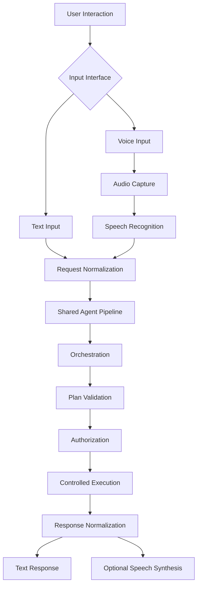
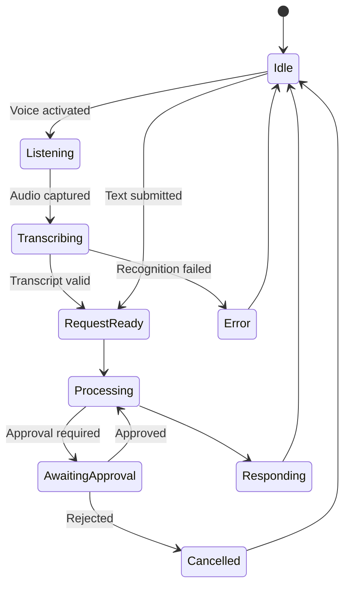

# Voice and Interaction Engineering Specification

**Document ID:** `CB-DOC-009`  
**Project:** ClawBot Agent  
**Version:** 1.0.0  
**Status:** Engineering Specification

---

## 1. Purpose

This document defines how users interact with ClawBot through text and voice.

The interaction system must support natural-language requests while maintaining a consistent internal request model.

Voice and text are separate input methods, not separate agent architectures.

Both must converge into the same request-processing, authorization, orchestration, execution, and response pipeline.

## 2. Design principles

1. Text interaction is a mandatory baseline.
2. Voice interaction is optional.
3. Voice and text must share a normalized request contract.
4. Microphone access must never be required for application startup.
5. Speech recognition must not grant additional permissions.
6. Speech output must be independently configurable.
7. Audio dependencies must be isolated from core dependencies.
8. The user must be able to interrupt or cancel supported operations.
9. Audio data must be handled according to explicit retention and privacy policies.
10. Device and engine failures must be observable and recoverable.

## 3. Interaction architecture



## 4. Interaction interfaces

### 4.1 Text interface

The text interface must provide:

- Request submission.
- Input validation.
- Conversation context handling.
- Response display.
- Error reporting.
- Cancellation where supported.
- Task status visibility.

Text mode must remain operational even if all audio dependencies are missing.

### 4.2 Voice interface

The voice interface may provide:

- Microphone discovery.
- Audio capture.
- Speech activity detection.
- Speech-to-text conversion.
- Voice activity status.
- Optional speech synthesis.
- Interruption and cancellation support.

Voice activation modes, such as push-to-talk or wake-word detection, must be independently configurable.

Always-listening behavior must not be enabled without explicit user configuration and a clear privacy policy.

## 5. Shared request contract

Both interfaces must produce the same normalized request structure.

Illustrative schema:

```json
{
  "request_id": "req-example-001",
  "session_id": "session-example-001",
  "input": {
    "type": "voice",
    "text": "Summarize my pending tasks"
  },
  "context": {
    "locale": "en-IN"
  },
  "metadata": {
    "timestamp": "ISO-8601"
  }
}
```

The `input.type` field identifies the source interface. It must not change the authorization rules.

The implementation must define and validate a formal schema for this contract.

## 6. Audio capture subsystem

### 6.1 Responsibilities

The audio capture subsystem must:

- Discover supported input devices.
- Open and close audio streams.
- Validate sample format and sample rate.
- Handle device disconnection.
- Manage capture buffers.
- Enforce input duration and size limits.
- Release audio resources correctly.

### 6.2 Device abstraction

Do not couple the voice pipeline directly to a single audio library.

Use an interface such as:

```python
class AudioInputAdapter:
    def list_devices(self):
        raise NotImplementedError

    def open_stream(self, device_id=None):
        raise NotImplementedError

    def read_audio(self):
        raise NotImplementedError

    def close_stream(self):
        raise NotImplementedError
```

This is an illustrative interface. The final implementation must define its exact method signatures and error contracts.

### 6.3 Device states

| State | Description |
|---|---|
| `UNAVAILABLE` | No usable device detected |
| `AVAILABLE` | Device detected |
| `INITIALIZING` | Device initialization in progress |
| `READY` | Capture can begin |
| `CAPTURING` | Audio capture active |
| `ERROR` | Device or stream error |
| `CLOSED` | Device released |

## 7. Speech recognition subsystem

### 7.1 Responsibilities

The speech recognition adapter converts audio into text.

It must provide:

- Engine initialization.
- Audio format validation.
- Transcription.
- Timeout handling.
- Confidence metadata where available.
- Error classification.
- Resource cleanup.

### 7.2 Adapter contract

The recognition interface should be replaceable so that different engines can be integrated without changing the core request pipeline.

Possible integration categories include:

- Local speech recognition.
- Remote speech recognition.
- Operating-system speech services.

Specific engines must be selected and validated during implementation.

### 7.3 Transcription validation

Before submitting recognized text:

- Reject empty transcripts.
- Apply input length limits.
- Preserve the original transcript where permitted.
- Validate encoding.
- Apply request normalization.
- Avoid silently executing uncertain transcriptions.

For sensitive actions, the interface should allow the user to review the recognized text before execution.

## 8. Speech synthesis subsystem

Speech synthesis is independent of speech recognition.

The TTS adapter should provide:

- Engine initialization.
- Text-to-audio conversion.
- Output device selection.
- Playback management.
- Cancellation.
- Resource cleanup.

The application must return a readable text response even if synthesis fails.

## 9. Request lifecycle

A voice request follows these stages:

1. Audio device readiness check.
2. Audio capture.
3. Speech recognition.
4. Transcript validation.
5. Request normalization.
6. Shared agent processing.
7. Response generation.
8. Optional speech synthesis.
9. Session state update.

A text request skips audio capture and speech recognition but follows the same shared agent processing stages.

## 10. Interaction state machine



The implementation must define state-transition validation and prevent invalid transitions.

## 11. Interruption and cancellation

The interaction layer must distinguish:

- Canceling audio capture.
- Canceling speech playback.
- Canceling a queued request.
- Requesting cancellation of a running task.

A cancellation request does not guarantee that an already-started external operation can be reversed.

The runtime must communicate whether cancellation was accepted, completed, or unavailable.

Sensitive operations must not continue after cancellation has been acknowledged as successful.

## 12. Privacy and audio retention

Audio is potentially sensitive user data.

The default policy should minimize retention.

Requirements:

- Do not persist raw audio by default.
- Do not log raw audio content.
- Avoid storing transcripts unless required by configured task-history behavior.
- Provide explicit retention configuration.
- Restrict access to stored interaction data.
- Protect temporary audio files.
- Remove temporary files after processing.
- Disclose when a remote speech service receives audio.
- Do not transmit audio to a remote service without the configured provider and privacy policy.

## 13. Failure handling

| Failure | Required behavior |
|---|---|
| No microphone | Keep text mode active |
| Permission denied | Explain required permission |
| Device disconnected | Stop capture and recover safely |
| Recognition timeout | Return a recoverable error |
| Empty transcript | Request another input |
| Low-confidence result | Ask for confirmation where supported |
| TTS unavailable | Return text response |
| Output device missing | Disable speech playback |
| Network failure | Apply configured engine fallback |
| Audio stream corruption | Close and report the stream failure |

## 14. Configuration

Example configuration:

```yaml
interaction:
  default_interface: text

  text:
    enabled: true
    maximum_input_characters: 10000

  voice:
    enabled: false
    activation_mode: push_to_talk

    input:
      enabled: false
      device_id: null
      maximum_recording_seconds: 60

    recognition:
      backend: null
      timeout_seconds: 30
      require_confirmation_for_sensitive_actions: true

    output:
      enabled: false
      backend: null
      automatic_playback: false

    privacy:
      persist_raw_audio: false
      persist_transcripts: false
```

These values are proposed defaults. They must be validated against the final configuration schema and the capabilities of selected adapters.

## 15. Testing requirements

| Test ID | Scenario | Expected behavior |
|---|---|---|
| `VOI-TST-001` | Text request | Shared request pipeline |
| `VOI-TST-002` | Valid voice input | Transcript produced |
| `VOI-TST-003` | Empty transcript | No execution |
| `VOI-TST-004` | Missing microphone | Text mode available |
| `VOI-TST-005` | Permission denied | Clear diagnostic |
| `VOI-TST-006` | Recognition timeout | Recoverable failure |
| `VOI-TST-007` | TTS unavailable | Text response available |
| `VOI-TST-008` | Audio disconnect | Safe stream cleanup |
| `VOI-TST-009` | Sensitive recognized command | Authorization still enforced |
| `VOI-TST-010` | Cancellation | Correct task state |
| `VOI-TST-011` | Temporary audio cleanup | No unintended retention |
| `VOI-TST-012` | Text/voice equivalence | Same authorization contract |

## 16. Implementation milestones

| ID | Deliverable |
|---|---|
| `VOI-M01` | Shared interaction contract |
| `VOI-M02` | Text interface |
| `VOI-M03` | Audio input abstraction |
| `VOI-M04` | Speech recognition adapter |
| `VOI-M05` | Transcript validation |
| `VOI-M06` | Speech synthesis adapter |
| `VOI-M07` | Interaction state machine |
| `VOI-M08` | Cancellation and interruption |
| `VOI-M09` | Privacy and retention controls |
| `VOI-M10` | Voice integration testing |

## 17. Acceptance criteria

- [ ] Text interface works independently.
- [ ] Voice input is optional.
- [ ] Text and voice produce the same normalized request type.
- [ ] Audio devices are discovered dynamically.
- [ ] Missing audio devices do not prevent startup.
- [ ] Recognition failures do not crash the runtime.
- [ ] TTS is independently configurable.
- [ ] Sensitive actions require the same authorization regardless of input method.
- [ ] Cancellation behavior is defined and tested.
- [ ] Audio retention follows explicit configuration.
- [ ] Voice behavior is covered by automated tests.

**Engineering principle:** Voice is an interaction adapter, not an alternate authorization or execution pathway.
